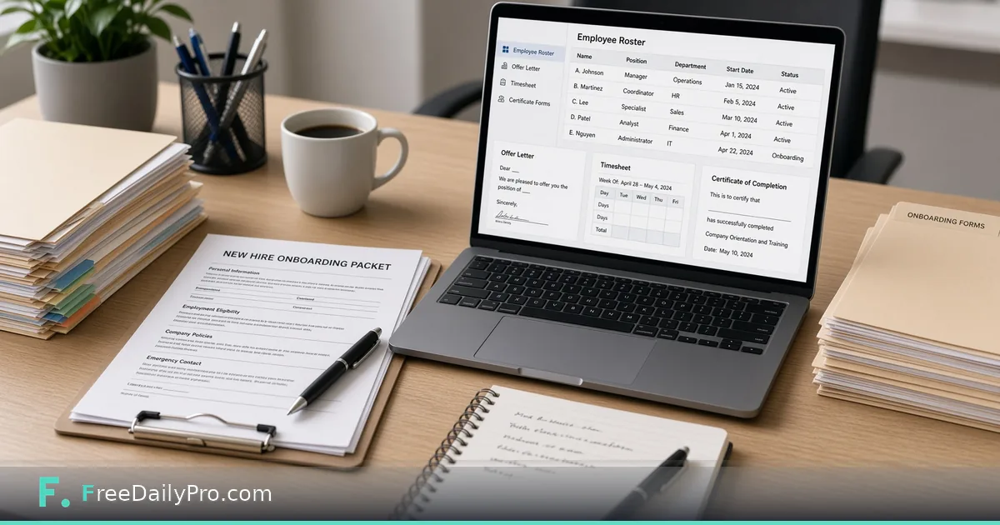

*Employee roster fills offer letter, pay stub, timesheet and certificate—plus onboarding ZIP*

[FreeDailyPro.com](https://www.freedailypro.com) -- Priya Shah runs people ops for a 28-person product company in Raleigh, North Carolina. Every new hire used to mean retyping the same name into an offer letter, a timesheet blank, and a welcome folder. [HR Desk](https://www.freedailypro.com/tool/hr-desk) is the workflow product for US employers: an employee roster that fills the offer letter, pay stub, timesheet, and certificate tools, with an onboarding packet ZIP and a document log.

This guide covers one job only: add a hire to the roster, generate the first documents from that row, and export the onboarding packet with a log entry.

## Not legal or HR advice—and not payroll

HR Desk keeps records and fills forms from your roster for US employers. Employment law differs by state and by worker type. Check the rules, or ask an adviser, before you issue a document. The pay stub tool shows figures you enter. It does **not** calculate taxes, file returns, or pay anyone.

Related: [Employment Offer Letter](https://www.freedailypro.com/tool/employment-offer-letter) remains available as a focused maker when you need that document outside the desk. [Invoice Generator](https://www.freedailypro.com/tool/invoice-generator) is unrelated to payroll but often sits nearby for contractor billing—do not confuse contractors with W-2 roster rows.

Browse [business tools](https://www.freedailypro.com/category/business-tools) for sibling office documents.

## Worked example: New analyst start date 2026-11-17

- People ops: Priya Shah
- Hire: A. Nguyen, Operations Analyst
- Start date: 17 Nov 2026
- Documents today: offer letter fields from roster, blank timesheet for first week, onboarding packet ZIP, log lines for each download
- Sensitive data: kept in the project file on a company laptop with disk encryption

Done means the packet ZIP matches what managers agreed to send, and the log shows who generated what and when.

## Steps in HR Desk

1. Open [HR Desk](https://www.freedailypro.com/tool/hr-desk) and confirm plan access (monthly workflow product; 7-day trial first time; cancel under the tool).
2. Add employees by hand or import a CSV. Verify spelling of legal names before any letter goes out.
3. Select the new hire row.
4. Generate the document you need: offer letter, pay stub, timesheet, or certificate. The roster fills the fields.
5. Review every field on screen. Titles, dates, and compensation figures are easy to swap between two hires if you rush.
6. Build the onboarding packet ZIP for the start-date bundle managers will share.
7. Confirm the log recorded the downloads. Treat the log as your internal proof of issue.
8. Save the project file. Employee details are not stored on FreeDailyPro servers. Treat the file as confidential personal data.

## Roster as single source

Priya’s rule: if it is not on the roster, it does not go in a letter. Title changes happen on the roster first, then documents are regenerated. That stops offer letters with last quarter’s job title.

## Common mistakes on hire week

- Issuing letters without checking state-specific requirements with counsel.
- Using the desk as a payroll calculator.
- Leaving the project file on a shared USB stick.
- Generating a packet before background-check timing is agreed.
- Mixing contractor invoice flows with employee roster documents.

## Limits and good to know

- HR Desk is $29.99 a month with a 7-day trial the first time. Cancel any time; access lasts through the paid month.
- Built for US employers; roster and log can work elsewhere, but packet wording and templates are US employment oriented.
- Not legal advice. Not a full payroll system.
- Files never stored on FreeDailyPro servers for this desk.
- FreeDailyPro offers 200+ professional tools; single-task Professional tools show 10 trial usages a day separately.

## First-week packet vs day-one packet

Priya keeps two packet recipes. Day-one packet is the minimum the hire needs on arrival: offer letter copy, handbook acknowledgment, timesheet blank, and building access note. First-week packet adds the training plan and any role certificate templates. She never dumps the full first-week set into day-one e-mail. New hires miss the important pages when the ZIP is huge. The desk log records which recipe she used, so if someone asks “did they get the handbook?”, she answers from the log instead of memory.

## Manager hand-off

Priya sends the packet ZIP, a one-line start-date reminder, and keeps the log internal. Managers do not get edit access to the roster file.

## CSV import without chaos

When Priya imports a CSV, she imports into a staging pass first: open the desk, import, fix two intentional typos she planted in a test row, delete the test row, then import production. That dry run catches column mismatches before a wrong start date lands on twelve letters.

## Certificates and training log

For roles that need a completion certificate after orientation, she generates the certificate from the roster only after the training owner signs off in the HR ticket—not before. The desk log then shows certificate download after the ticket close date, which matches her audit story.

## FAQ

**Does HR Desk run payroll?**
No. Pay stub figures are what you enter. It does not calculate taxes or pay people.

**Is this legal advice?**
No. US employment rules vary. Check requirements or ask an adviser before issuing documents.

**Where are employee details stored?**
In a project file on your device. Treat it as sensitive personal data. FreeDailyPro does not store it on a server for this desk.

## Offer letter fields without retyping

Priya’s rule is mechanical: legal name, title, start date, and compensation figures live only on the roster row. When leadership changes a start date, she edits the row once, regenerates the offer letter, and the packet ZIP is rebuilt. She does not patch a PDF in a desktop editor after the fact, because that creates a second source of truth that never updates the log.

When two hires start the same week, she generates each packet in a separate session and checks the log for both names before she closes the laptop. Swapped titles between two similar roles are the failure mode she guards against hardest.

## Timesheets and first-week logistics

The blank timesheet for week one is generated from the same row so the employee name and department already match the offer. Priya attaches it inside the onboarding packet rather than sending a separate file that can drift. Managers still own approval of hours; the desk only issues the blank form and records that it was generated.

## What the log is for

The document log is not decoration. When a manager asks “did we actually send the offer?”, Priya answers with the log line and the packet ZIP timestamp. That is also why she does not generate certificates early: the log should match reality. If HR audit asks for who issued which document, the log is the first file she opens.

## Separating contractors from employees

Contractors are billed and scoped outside the employee roster. Priya keeps contractor paperwork in a different folder and uses invoice-oriented tools when needed. Putting a contractor on the W-2 roster “just to get a letter” is how wrong templates and wrong tax assumptions start. HR Desk packet wording is for US employment; contractor relationships need different documents and different counsel.

## Scenario: title change after verbal offer

Leadership renames the role two days after a verbal offer. Priya updates the roster title first, regenerates the offer letter, rebuilds the packet, and e-mails the corrected ZIP with a one-line change note. She never edits the PDF title by hand. The log shows both generations, which is intentional—it records the correction path.

## When not to use HR Desk

If you need full payroll, benefits administration, or multi-country HRIS workflows, this desk is the wrong product. It is a roster-plus-packet tool for small US employers who want documents filled from one row without uploading employee data to a vendor vault.

## FAQ (expanded)

**Can I import a CSV of employees?**
Yes. Import, verify legal names and start dates, then generate documents. Dry-run with a test row first when the spreadsheet is new.

**Does the pay stub calculate withholdings?**
No. You enter the figures. The desk does not file returns or move money.

**What about employee handbooks?**
Handbook content is company-specific policy writing. The desk helps with roster-filled documents and onboarding packets; it does not author your handbook text.

**Who can open the project file?**
Only people who should see personal employment data. Treat the file like an HR folder, not a shared marketing drive.

## Closing next step

Onboarding fails when names are retyped under pressure. Open [HR Desk](https://www.freedailypro.com/tool/hr-desk), enter one upcoming hire completely, generate the offer fields from the roster, and export the packet before day one.

If you need a multi-state hiring checklist discussion next, contact [https://www.freedailypro.com/contact](https://www.freedailypro.com/contact)—and verify local law before you rely on any template.
