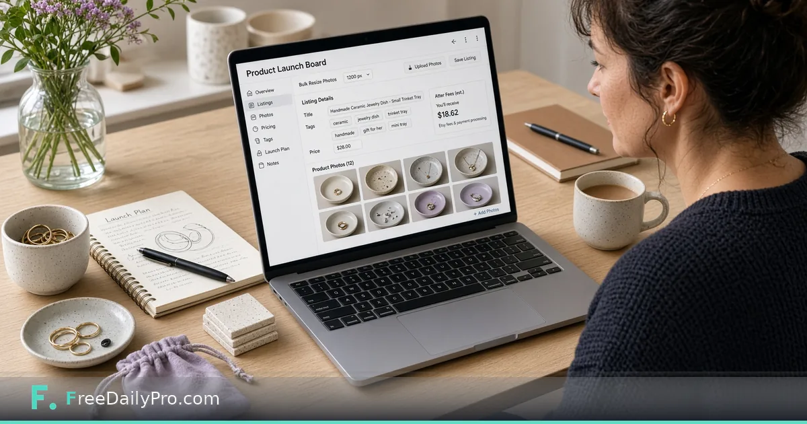

*Shop-wide launch board: photo checks, title and tags, audit, price finder, profit after fees*

[FreeDailyPro.com](https://www.freedailypro.com) -- Lila Brooks sells handmade ceramic jewelry dishes from a studio in Portland, Maine. She already knows how to list on Etsy; her pain is the hour before publish when photos, titles, tags, and fee math live in four places. [Seller Studio](https://www.freedailypro.com/tool/seller-studio) is the workflow product launch board for a whole shop: photo checks and bulk resizing, title and tag checks, a shop audit, price finder, and profit after your fees.

This guide is the **overview** pass: how the board holds photos, text, and price together so you stop treating them as three separate chores. For a deeper seasonal batch walkthrough, see the existing post [Launch a Product Batch With Seller Studio](https://www.freedailypro.com/blog/launch-etsy-batch-with-seller-studio).

## What the board is for

Seller Studio does not publish listings and does not connect to your shop. You type details, run checks, and download what you need. Photos are checked and resized in the browser and only leave as a ZIP you download. Profit uses price, minus cost, minus shipping you pay, minus the percentage and fixed fee you entered.

Sibling tools: [Seller Pricing Desk](https://www.freedailypro.com/tool/seller-pricing-desk) when you want a pure pricing sheet, [Marketplace Fee Calculator](https://www.freedailypro.com/tool/marketplace-fee-calculator) and [Profit Margin Calculator](https://www.freedailypro.com/tool/profit-margin-calculator) for quick math. Browse [ecommerce tools](https://www.freedailypro.com/category/ecommerce-tools) for related helpers.

## Worked example: twelve-SKU jewelry dish shop

- Seller: Lila Brooks
- Marketplace guidance: Etsy photo sizes and listing limits
- Target margin: 40% of price (margin, not markup)
- Fees: percentage + fixed fee copied from the marketplace fee page that morning
- Shipping she pays: $3.50 average mailer
- Board goal: every active SKU either ready or blocked with one clear reason (photo, title, tag, or price)

## Steps for a shop-wide pass

1. Open [Seller Studio](https://www.freedailypro.com/tool/seller-studio) and enter live marketplace and payment fees—not last season’s memory.
2. Set target margin as a percent of selling price.
3. Pick marketplace photo guidance so bulk resize matches published rules.
4. Add or open each product: title, tags, price, cost, shipping you pay, photos.
5. Read photo status, title and tag checks, and profit after fees on the same row.
6. Use the price finder when profit is short: it works out the lowest price that still leaves your typed margin after cost, shipping, and fees.
7. Open the shop audit view to see ready versus blocked SKUs across the catalog.
8. Download photo ZIPs for SKUs you will list this week. Save or back up the project on your device.
9. List on the marketplace only from board-ready rows.

## Photos, text, and price as one pass

Lila’s old order was photos on Monday, titles on Tuesday, prices on Thursday—which meant fee changes mid-week broke Thursday’s math. One pass forces fee entry first, then every SKU inherits the same rules. Title checks catch length problems; they do not write poetry. Photo checks catch size guidance; they do not judge composition. Profit catches underwater prices; it does not set brand positioning.

## Common mistakes on overview day

- Entering fees once in January and never again.
- Confusing margin with markup.
- Leaving shipping you pay at zero.
- Expecting Seller Studio to push to Etsy or Shopify.
- Treating green checks as marketing approval.

## Limits and good to know

- Seller Studio is $29.99 a month with a 7-day trial the first time. Cancel any time; access lasts through the paid month.
- No shop connection, no auto-publish.
- Profit uses only the figures you type.
- Photos stay on-device until you download a ZIP.
- Professional tools’ 10 trial usages a day do not replace this subscription.
- FreeDailyPro offers 200+ professional tools beyond Seller Studio.

## Photo ZIP naming Lila trusts

After bulk resize, Lila downloads a photo ZIP and renames it with shop code, date, and SKU range before she opens the marketplace uploader. Example: `NCS-2026-11-10-dishes-12-18.zip`. The Studio does not name the marketplace listing for her; she still pastes titles and tags by hand. The ZIP name is only her local trail so she can re-open the same set if a listing fails half-way. She never reuses last month’s ZIP name, even for the same SKUs, because marketplace support tickets get messy when two uploads share a label.

## How this differs from the batch post

The batch post walks a multi-SKU launch with a tight seasonal story. This overview is the mental model for running the whole shop on the board—audit first, then list. Use both: overview for weekly hygiene, batch post for drop week intensity.

## Audit-first weekly routine

Monday morning Lila opens Seller Studio, confirms fees still match the marketplace fee page, and runs the shop audit. Anything red on price or photo is a listing freeze until fixed. Titles that merely warn on length get a same-day edit; she does not wait for a seasonal drop.

## Price finder without race-to-bottom

The price finder answers “what is the lowest price that still hits my margin after fees?” It does not answer “what should my brand charge?” Lila uses it as a floor check. If the floor sits above her brand price, she redesigns cost or shipping rather than silently selling at a loss.

## FAQ

**Does Seller Studio upload photos or connect to my shop?**
No. Checks and resizing run in the browser. It does not publish or sync listings.

**How is profit calculated?**
Price minus cost minus shipping you pay minus the percentage and fixed fee you entered. Nothing else is invented.

**How is this different from Seller Pricing Desk?**
Seller Pricing Desk is a focused pricing workflow. Seller Studio is the full launch board including photos, titles, tags, audit, and profit together.

## Fee entry is step zero

Lila opens the marketplace fee page before she opens any product row. Percentage and fixed fee go into Seller Studio first. If payment processing fees apply on top, she includes them in the figures she types. Profit after fees is only as honest as that morning’s fee sheet. January fees left untouched in June are how “healthy” margins become losses.

## Bulk photo resize without uploading

Photos are checked and resized in the browser. They leave only as a ZIP she downloads. That means she can work on a train without pushing product images into a random cloud folder. She still keeps originals in her studio library; the board ZIP is the listing-ready set for this week’s publish batch.

## Title and tag checks are length and structure, not voice

The board flags listing text that breaks marketplace limits. It does not write brand voice for her. Lila still reads every title aloud once. A green check means “within rules,” not “this will rank.” Tags get the same treatment: within limits first, then human judgment.

## Scenario: fee change mid-season

The marketplace updates a fixed fee mid-season. Lila updates Seller Studio the same day and re-runs profit on active SKUs before she discounts anything for a sale. Two dishes that looked fine last week now sit under margin. She either raises price with the price finder floor as a guide, or she redesigns packaging cost. She does not publish a sale that sells at a loss by accident.

## Shop audit as a freeze list

Audit view is a traffic light for the catalog. Red on photo size or underwater profit is a listing freeze. Yellow title warnings are same-day edits. Lila does not “ship anyway” on red rows because the board is green elsewhere. The point of one board is that ready means ready on photos, text, and price together.

## When not to use Seller Studio

If you need marketplace API sync, automatic publish, or multi-channel inventory reservation, this is the wrong product. Seller Studio is a launch board you operate by hand for shops that want checks and profit math without connecting the store.

## Sibling math tools without abandoning the board

When she wants a quick fee experiment without touching the full board, she still opens [Marketplace Fee Calculator](https://www.freedailypro.com/tool/marketplace-fee-calculator) or [Profit Margin Calculator](https://www.freedailypro.com/tool/profit-margin-calculator). Final listing decisions return to Seller Studio so the SKU row stays the source of truth for that product’s ready state.

## FAQ (expanded)

**Does profit include tax?**
No. Profit uses price, cost, shipping you pay, and the fee figures you enter. Tax and currency swings are outside the model.

**Can I use it for marketplaces other than Etsy?**
You enter fees and photo guidance that match the channel you sell on. Title and tag checks follow the limits the product documents; confirm each marketplace’s current rules before you publish.

**What does the price finder optimize for?**
The lowest price that still leaves your typed margin after cost, shipping, and fees. It is a floor tool, not a brand strategy tool.

**Do I need Seller Pricing Desk as well?**
Only if you want a dedicated pricing sheet workflow. The Studio already includes price finder and profit for launch-board work.

## Closing next step

Listings fail in the gaps between tools. Open [Seller Studio](https://www.freedailypro.com/tool/seller-studio), enter today’s fees, run the audit, and clear one blocked row before you open the marketplace tab.

If you want a non-Etsy marketplace overview next, say which channel at [https://www.freedailypro.com/contact](https://www.freedailypro.com/contact).
