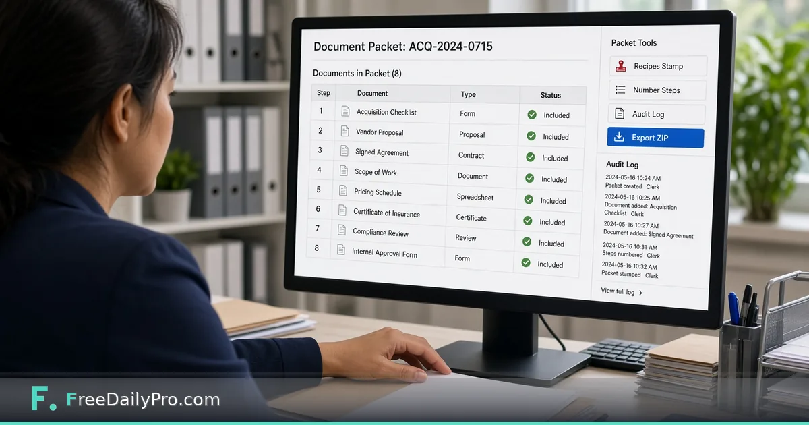

*Order a packet, run a recipe from scan to sign, keep an audit log, export one ZIP*

[FreeDailyPro.com](https://www.freedailypro.com) -- Jordan Hale coordinates vendor onboarding for a regional logistics firm in Charlotte, North Carolina. A single vendor file can include a checklist, proposal, signed agreement, insurance certificate, and pricing schedule—each arriving as a separate scan. [Document Operations Desk](https://www.freedailypro.com/tool/document-operations-desk) is the workflow product for general office packets: ordered documents, recipes from scan to sign, an audit log, and one-click packet export.

This guide covers one job only: build a packet, apply a recipe across every document, and hand off a ZIP with a clear log of what ran.

## Document Operations vs Legal Production Desk

[Legal Production Desk](https://www.freedailypro.com/tool/legal-production-desk) is for legal productions with Bates ranges, production logs, and withheld lists. Document Operations Desk is for general office packets—loan files, onboarding packs, claims, vendor files. It orders documents, runs your recipe on each one, and exports a ZIP with a manifest. Do not force Bates-style production habits onto a routine office packet if you only need order, process, and hand-off.

Sibling engines the desk can lean on include [OCR PDF](https://www.freedailypro.com/tool/ocr-pdf), [Redact PDF](https://www.freedailypro.com/tool/redact-pdf), and [Merge PDF](https://www.freedailypro.com/tool/merge-pdf). Browse [pdf tools](https://www.freedailypro.com/category/pdf-tools) when you need a one-off outside a packet project.

## Worked example: Vendor packet ACQ-2026-0715

- Coordinator: Jordan Hale
- Packet id: ACQ-2026-0715
- Documents (8): acquisition checklist, vendor proposal, signed agreement, scope of work, pricing schedule, certificate of insurance, compliance review, internal approval form
- Recipe: OCR where needed → redact internal notes → number pages → compress for e-mail
- Output: ZIP + audit log + manifest

Done means every document is either processed in order or explicitly skipped with a note—not missing page 7 of the insurance cert.

## Steps on Document Operations Desk

1. Open [Document Operations Desk](https://www.freedailypro.com/tool/document-operations-desk) and create a packet project with a stable id (Jordan uses the acquisition code).
2. Add documents in the order a reviewer should read them. Reorder before you run recipes, not after.
3. Define a recipe as an ordered list of steps—examples on the live product include OCR, redact, number pages, and compress.
4. Apply the recipe across the packet. Watch the audit log as each step lands.
5. Open any redacted file and verify sensitive lines are truly gone before you share—OCR and redact use the same engines as the standalone tools, and you remain responsible for the final check.
6. Export the packet ZIP with its manifest. Keep the audit log with the hand-off e-mail.
7. Save the project file on your device. The project lists documents and notes; document contents stay local unless you choose to include them.
8. For the next vendor, duplicate the packet shell and swap files instead of reinventing the recipe.

## Recipes and audit log

A recipe is your standard operating order. The audit log is how you prove the order ran. When compliance asks “was insurance OCR’d before export?”, the log should answer without a scavenger hunt through chat history.

## Common mistakes on packet day

- Mixing Legal Production Bates habits into a simple office packet and overcomplicating the job.
- Trusting OCR on handwriting-heavy scans without a human pass.
- Redacting once and never re-checking after a re-export.
- Exporting without the manifest so the recipient cannot see what should be inside.
- Assuming files upload to FreeDailyPro. Steps run in the browser; nothing is stored as a document vault on the server.

## Limits and good to know

- Document Operations Desk is $29.99 a month with a 7-day trial the first time. Cancel any time; access continues through the paid month.
- OCR reads typed and printed text best. Always verify redactions before sharing.
- Project files live on your device.
- Professional single-task tools still offer 10 trial usages a day; that allowance does not replace this subscription.
- FreeDailyPro offers 200+ professional tools for tasks outside the desk.

## Hand-off checklist Jordan uses

Subject line includes the packet id. Body lists document count. Attachment is the ZIP only. Audit log PDF or export sits in the internal ticket. If a reviewer rejects page order, Jordan fixes order in the desk and re-exports rather than renaming files in Finder.

## Naming packets so humans can find them

Jordan’s packet ids always match the ticket system: `ACQ-YYYY-####`. Folder names on disk match the packet id. The ZIP name matches the packet id. When someone forwards only the ZIP six months later, the id still resolves in search.

## Redaction second look

Even when the recipe includes redact, Jordan opens the two riskiest documents—the agreement and the insurance cert—full screen before export. He searches for the vendor’s bank digits and internal e-mail aliases. If anything remains, he fixes and re-runs that document only, then re-exports the packet so the audit log shows the rework.

## FAQ

**How is this different from Legal Production Desk?**
Legal Production Desk is for Bates productions and withheld lists. Document Operations Desk is for general office packets like onboarding, loans, and vendor files.

**Are documents uploaded?**
No. Steps run in your browser. Save the project and ZIP yourself.

**Can recipes include OCR and redact?**
Yes. The desk uses the same engines as the OCR PDF and Redact PDF tools. Always verify output before sharing.

## Recipe order that actually works

Jordan’s default recipe for vendor packets is deliberate: OCR first on scans that need text, redact second so searchable text can be found and removed, number pages after final order is locked, compress last for e-mail size. Numbering before reorder is how page 1 becomes page 4 in the reader’s eyes. He writes the recipe name into the packet notes so a substitute coordinator can run the same order next month.

## Audit log as the e-mail attachment’s twin

The ZIP is for the recipient. The audit log is for Jordan’s ticket. He never sends the log to the vendor unless counsel asks for it. Internally, the log answers which steps ran, on which documents, and whether a rework pass happened after a redaction miss.

## Large packets and browser memory

Very large sets live in browser memory. When a packet grows past comfort, Jordan splits into part A and part B with clear ids (`ACQ-2026-0715-A`, `…-B`), same recipe, and a parent ticket that lists both ZIPs. He does not force a giant set through one tab until the browser stalls.

## Scenario: insurance cert missing a page

Export day reveals the insurance certificate is missing page 2. Jordan does not ship. He marks the document blocked in notes, requests the page, inserts it in the correct order, re-runs OCR on that document only if needed, re-numbers the packet, and re-exports. The audit log shows the rework. The vendor still receives one coherent ZIP, not a “plus this page” follow-up that gets lost.

## When to use Legal Production Desk instead

If the job needs Bates ranges, a production log, and a withheld list, use [Legal Production Desk](https://www.freedailypro.com/tool/legal-production-desk). Document Operations Desk is the general office path for ordered packets without Bates machinery. Choosing the wrong desk creates either under-documented legal productions or over-complicated vendor onboarding.

## Signing step limits

When a recipe includes a sign step, Jordan treats it as a drawn or placed signature workflow on the page—not as a full certificate-authority e-sign platform. For contracts that need formal e-sign, he uses the company’s designated signing system and only packs the resulting PDF into the desk. The desk is a packet factory, not a replacement for regulated signing products.

## FAQ (expanded)

**Does the desk certify archival authenticity?**
No. It is not a certified archival system. It orders, processes, logs, and exports.

**Should OCR run after redaction?**
Usually no. OCR first so text can be found, then redact, then number. Always re-check redactions after any re-export.

**Can I reuse a packet shell?**
Yes. Duplicate the shell, swap files, keep the recipe, change the packet id to match the new ticket.

**What belongs in the manifest?**
Document names in final order, packet id, and enough detail that a recipient can see what should be inside without opening every file first.

## Closing next step

A packet is a product, not a pile. Open [Document Operations Desk](https://www.freedailypro.com/tool/document-operations-desk), build one recipe you trust, and export one audited ZIP for a real vendor or claim file.

If you need a sample recipe for claims versus onboarding next, write to [https://www.freedailypro.com/contact](https://www.freedailypro.com/contact).
