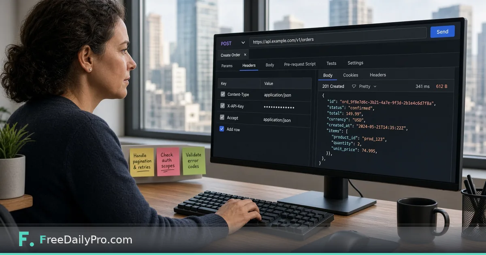

*Import the public collection, set X-API-Key, run a live word-count request*

[FreeDailyPro.com](https://www.freedailypro.com) -- Priya Nair teaches a weekend backend workshop in Toronto. Students freeze when a README only shows curl. The FreeDailyPro [developers](https://www.freedailypro.com/developers) page now points at a public Postman workspace and documentation view so a first live call is a button, not a blank file. This post is that two-minute path—plus the mistakes that burn an hour.

This guide covers one job only: open the collection, set the key as an environment variable, and send a real request against production.

## Where the links live

On the developers resources list:

- **Postman documentation** — public collection with requests pre-filled (documentation view: `https://documenter.getpostman.com/view/57830674/2sBYAytUod`).
- **Postman workspace overview** — `https://www.postman.com/freedailypro-3310105/freedailypro-api-246-endpoints/overview`.
- **OpenAPI file** — `https://api.freedailypro.com/openapi.json` for codegen and contract checks.
- **RapidAPI** — optional playground if the team already lives there.

The developers FAQ states both Postman and RapidAPI hit the **same production API**, not a mocked sandbox.

## Worked example: word-count in class

- Instructor: Priya Nair
- Sample text: “Postman sends live FreeDailyPro calls.”
- Header: `X-API-Key` from a trial key she created in class
- Success: JSON with a word count; students compare with browser [Word Counter](https://www.freedailypro.com/tool/word-counter)
- Follow-up: slug style checks against [Slug Generator](https://www.freedailypro.com/tool/slug-generator); pretty-print payloads with [JSON Formatter](https://www.freedailypro.com/tool/json-formatter)

## Steps (two minutes when the network cooperates)

1. Create a key on [developers](https://www.freedailypro.com/developers) (trial, no card required).
2. Open the Postman documentation or workspace link from that page.
3. Fork or import the FreeDailyPro collection into your Postman account.
4. Create an environment variable, for example `FDP_API_KEY`, and paste the key value only in the environment—not in a shared collection description.
5. Map the collection’s API key header to `{{FDP_API_KEY}}` if it is not already wired. Header name must be **`X-API-Key`**.
6. Select a simple text request (word-count style) and send.
7. Confirm status 200 and a sensible JSON body.
8. Optional: without a key, the developers page also documents a limited browser “try it now” path at **10 calls per hour per IP**—useful for demos, not for workshops of thirty students on one NAT.

## curl twin for the same habit

```bash
curl -X POST https://api.freedailypro.com/v1/text/word-count \
  -H "X-API-Key: YOUR_API_KEY" \
  -H "Content-Type: application/json" \
  -d '{"text":"Postman sends live FreeDailyPro calls."}'
```

Exact path names can be copied from the collection or OpenAPI; students should trust the live collection over memory.

## Common mistakes

- Using `Authorization: Bearer` because another vendor taught that pattern.
- Putting the raw key inside a collection that gets exported to GitHub.
- Regenerating the key on the website and forgetting to update the Postman environment.
- Testing huge media uploads on trial keys without reading size/time caps (trial keys: on the order of 25 MB and 60 seconds for many media operations—over-limit returns 413/422 and are not billed per developers copy).
- Assuming Postman is offline-mocked when errors are real 401/429 from production.

## Limits and good to know

- Trial: 20,000 calls/month shared across endpoints and MCP; paid tiers at $24 / $69 / $129 as listed on developers.
- Processing in memory; developers copy: nothing you send is stored.
- Overview: [API and MCP server-side tools](https://www.freedailypro.com/blog/api-mcp-server-side-tools).
- FreeDailyPro offers 200+ professional tools for browser work beside the API.


## Environment hygiene for teams

Priya’s rule for any shared Postman workspace: keys live only in **personal** or **local** environments, never in the collection JSON that gets exported. Collection variables may hold the header *name* (`X-API-Key`) but not the secret. When a contractor finishes the weekend workshop, they rotate the key on the developers page so old environment files die quietly.

She also pins a one-line description on the environment: “Production FreeDailyPro — rotate on offboarding.” That label stops someone from cloning a staging habit onto a live key without noticing.

## Which request to run first

Start with a text utility such as word-count. It is fast, returns JSON, and fails loudly on a bad key (401) without uploading files. Only after 200s look clean should the class open PDF merge or media routes that need sample files and larger trial caps. Students who jump straight to video compress on a shared hotel Wi-Fi spend the hour debugging network timeouts instead of headers.

## Reading errors without panic

- **401** — missing or stale key; confirm header name and regeneration.
- **429** — plan call limit; wait or upgrade; do not tight-loop retries in a demo.
- **413 / 422** on media — trial size or duration caps; shrink the sample.
- **400** — body field names wrong; copy the example from the collection, do not invent property names from memory.

Priya puts this list on the whiteboard. It turns scary red status codes into a checklist.

## Classroom protocol Priya uses

Each student creates **their own** trial key. She never projects a live key. When the session ends, students regenerate keys if the laptop is shared. For demos she uses only sample sentences, never customer data.

## From Postman to CI

Once a request works in Postman, Priya exports the curl and pastes it into a GitHub Action secret-backed step. Postman remains the teaching UI; CI remains the long-term runner. The collection is the contract the team argues about before code freezes.

## FAQ

**Is the Postman collection a sandbox?**
No. Requests are live against production with your key (or the limited key-less demo where documented).

**What header name is required?**
`X-API-Key`.

**Where do I get OpenAPI?**
`https://api.freedailypro.com/openapi.json` plus per-job specs linked from developers.

## Closing next step

Reading OpenAPI is valuable; sending one live call teaches faster. Open [developers](https://www.freedailypro.com/developers), launch Postman from the resources list, set `X-API-Key`, and run word-count on a sample sentence.

If you want a screenshot series for Postman v11 UI labels next, ask at [https://www.freedailypro.com/contact](https://www.freedailypro.com/contact).
