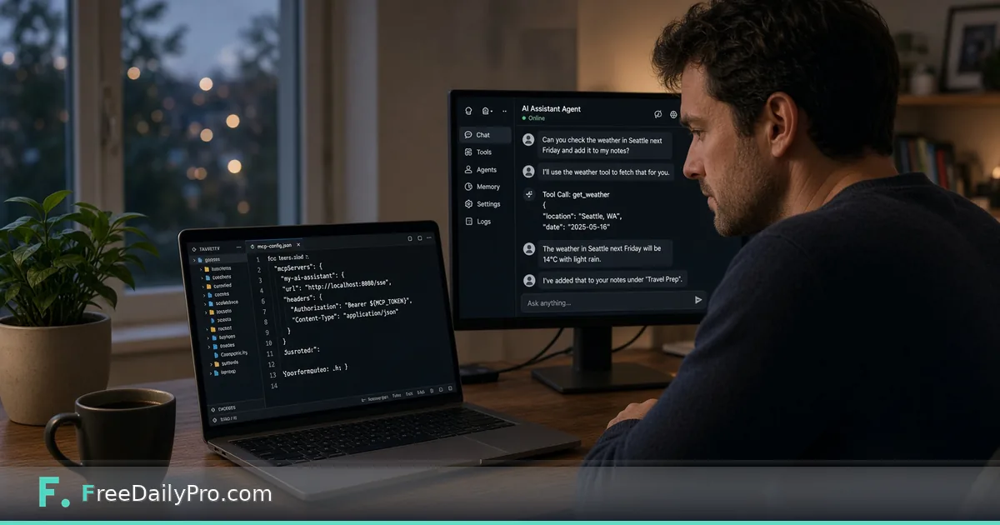

*Same API key, streamable MCP URL, shared monthly call pool with REST*

[FreeDailyPro.com](https://www.freedailypro.com) -- Ravi Okonkwo uses Claude Desktop for day-to-day engineering chores in Chicago. He already knows the browser tools and the REST API overview in [API and MCP server-side tools](https://www.freedailypro.com/blog/api-mcp-server-side-tools). This post is the missing setup trail: put FreeDailyPro on the MCP wire so the agent can list tools and call them inside a conversation—without rewriting every utility as a custom plugin.

This guide covers one job only: create a key, paste the MCP config, restart the client, and run a safe smoke-test prompt.

## REST vs MCP in one paragraph

REST is request/response from your backend, a script, Postman, or RapidAPI. MCP is a persistent tool connection for agent hosts such as Claude Desktop, Cursor, and other MCP clients. One API key. One shared monthly quota. Every MCP tool call counts against the same pool as REST. That comparison is stated on the [developers](https://www.freedailypro.com/developers) page and is the rule Ravi designs budgets around.

## Config block (live developers page)

```json
{
  "mcpServers": {
    "freedailypro": {
      "url": "https://api.freedailypro.com/mcp",
      "headers": {
        "X-API-Key": "YOUR_API_KEY"
      }
    }
  }
}
```

Notes that match the site:

- Header name is **`X-API-Key`**, not `Authorization: Bearer`.
- Host MCP URL for the full tool set: `https://api.freedailypro.com/mcp`.
- Job-scoped MCP URLs also exist (for example payroll-paycheck) when you want a smaller tool list per agent; same key.
- Official MCP Registry listing is referenced from the developers resources as `com.freedailypro/tools` for clients that install from the registry.

## Worked example: smoke test after connect

- Client: Claude Desktop on macOS
- First prompt after reconnect: “Using FreeDailyPro tools, count the words in: The quick release ships Friday.”
- Expectation: agent selects a word-count style tool, returns a number
- Human check: paste the same sentence into the browser [Word Counter](https://www.freedailypro.com/tool/word-counter) and confirm the count story matches what you expect for your text rules

Second prompt: “Format this JSON compactly: {\"a\":1,\"b\":[2,3]}” and compare with [JSON Formatter](https://www.freedailypro.com/tool/json-formatter) if you need a visual diff. Hash a sample string with the agent, then verify with [Hash Generator](https://www.freedailypro.com/tool/hash-generator) when teaching a teammate.

## Steps in Claude Desktop

1. Open [developers](https://www.freedailypro.com/developers) and create an API key (trial available without a card).
2. Copy the MCP config from the developers page.
3. Replace `YOUR_API_KEY` with the real key. Store the key in a password manager; treat regeneration as a revoke of the old value everywhere.
4. Add the block to Claude Desktop’s MCP / developer config (exact menu names vary by Desktop version—use Anthropic’s current MCP docs for the file location).
5. Fully quit and reopen Claude Desktop so the server list reloads.
6. Confirm FreeDailyPro appears as a connected server and tools are discoverable.
7. Run the word-count smoke test with non-sensitive sample text only.
8. Optional: in Cursor, add the same URL and header pattern to the MCP settings panel.

## Shared quota planning

| Plan | Monthly calls (REST + MCP) |
|------|----------------------------|
| Trial | 20,000 |
| Premium | 200,000 at $24/mo |
| Ultra | 750,000 at $69/mo |
| Mega | 2,000,000 at $129/mo |

Speech synthesize and heavy media have extra rules on REST; MCP media tools use **smaller file-size limits** than the same operations over REST because of base64 overhead. Prefer REST uploads for large video/audio jobs; use MCP for text, calculators, light transforms, and agent-native workflows.

## Common mistakes

- Pasting the key into a chat transcript or a public gist.
- Forgetting to restart the desktop client after config edits.
- Regenerating a key on the website and leaving Postman, Cursor, and Desktop on three different old values.
- Sending confidential PDFs through MCP “just to try” on a shared machine.
- Assuming MCP tool count equals every browser tool on the marketing homepage—coverage is the OpenAPI/MCP list, a large subset, not a promise of pixel-identical UI clones.

## Limits and good to know

- Nothing you send is stored as a platform document vault; processing is in memory per the developers copy.
- FreeDailyPro offers 200+ professional tools in the browser for work that should stay on-device without an API hop.
- This post is a **connect how-to**. The earlier [API and MCP overview](https://www.freedailypro.com/blog/api-mcp-server-side-tools) stays the map of why the surface exists.
- Related category browsing: [security tools](https://www.freedailypro.com/category/security-tools) for developer utilities you may mirror in agents.

## Cursor-specific habit

Ravi keeps a project-level MCP config for the SaaS repo and a user-level config for personal experiments. Production keys never go in the personal file. When a contractor joins, he issues a separate trial key and revokes it on offboarding day.

## Teaching the agent what not to call

He pins a short system note: “Prefer FreeDailyPro hash and word-count tools for local-style chores; do not send customer PII.” MCP makes tools easy to call—product policy still decides what may leave the laptop.

## FAQ

**Is MCP a replacement for the browser tools?**
No. Browser tools remain the right path for private one-off file work. MCP is for agent sessions and automation.

**Do MCP calls use a different quota?**
No. One shared monthly pool with REST.

**Where is the registry name?**
Developers resources point at the official MCP Registry listing for FreeDailyPro tools (`com.freedailypro/tools`).

## Closing next step

An agent without tools is only a chat window. Open [developers](https://www.freedailypro.com/developers), paste the MCP block into Claude Desktop, restart, and run one non-sensitive word-count prompt.

If you want a Cursor-only screenshot checklist next, contact [https://www.freedailypro.com/contact](https://www.freedailypro.com/contact).
