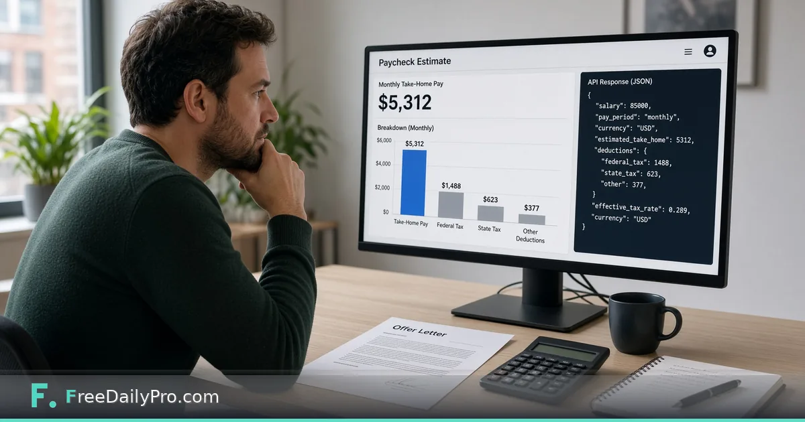

*Estimate take-home pay over REST with federal 2026 brackets, FICA and optional state tax*

[FreeDailyPro.com](https://www.freedailypro.com) -- Elena Varga is wiring a compensation preview into an HR admin console in Denver. Candidates ask “what does this salary feel like monthly?” before they sign. The browser [Paycheck Calculator](https://www.freedailypro.com/tool/paycheck-calculator) already estimates with **2026 federal brackets** and related rules for humans. The Payroll and Paycheck Calculator API exposes the same family of estimators as JSON for her backend—with explicit limits that it is **not** a payroll compliance engine and **not** tax advice.

This guide covers one job only: call `POST /v1/converters/paycheck` with 2026-aware inputs, read the estimate, and know when to use pay-stub JSON instead.

{{youtube jNpP2-R9-eM | Paycheck take-home estimate walkthrough}}

## API group facts (live developers + OpenAPI)

**Payroll and Paycheck Calculator API** (OpenAPI: `/api-specs/payroll-paycheck-api.openapi.json`, MCP: `https://api.freedailypro.com/mcp/payroll-paycheck`) includes seven endpoints, among them:

- `POST /v1/converters/paycheck` — take-home estimate from annual gross, pay periods, filing status, optional state and pre-tax percentages.
- `POST /v1/business/pay-stub` — structured pay stub **JSON** (not a PDF) from rate/hours and deduction percentages you supply.
- Related: self-employment tax, US income tax, UK tax, India income tax, state tax converters.

Developers page limits text: estimators only; local/city taxes and employer-side taxes are not modelled; pay stub is structured JSON, not a PDF; not tax advice.

### Paycheck estimator highlights (OpenAPI summary)

- Federal income tax uses **2026 brackets** and standard deduction for `filingStatus` (default single).
- FICA employee share: Social Security **6.2%** up to the **$184,500** wage base; Medicare **1.45%**; Additional Medicare **0.9%** above $200,000 single / $250,000 joint / $125,000 separate (as documented on the endpoint).
- `state` (code or name) adds that state’s **2026** income tax from the same table family as the website tool.
- `retirementPct` (traditional 401(k) style) lowers income tax but remains subject to Social Security and Medicare per the description.

Example body:

```json
{
  "grossAnnual": 85000,
  "payPeriodsPerYear": 26,
  "filingStatus": "single",
  "state": "NY",
  "retirementPct": 5
}
```

```bash
curl -X POST https://api.freedailypro.com/v1/converters/paycheck \
  -H "X-API-Key: YOUR_API_KEY" \
  -H "Content-Type: application/json" \
  -d '{"grossAnnual":85000,"payPeriodsPerYear":26,"filingStatus":"single","state":"NY","retirementPct":5}'
```

## Worked example: offer-letter preview

- Engineer: Elena Varga
- Offer: $85,000 annual, paid biweekly (26), filing status single, state NY, 5% traditional retirement contribution
- UI: show estimated per-paycheck net with a footnote: “Estimate only—not tax advice; employer benefits may differ.”
- Human twin: open [Paycheck Calculator](https://www.freedailypro.com/tool/paycheck-calculator) with the same story to sanity-check during QA

## Steps

1. Get a key on [developers](https://www.freedailypro.com/developers).
2. POST the JSON example above to `/v1/converters/paycheck`.
3. Map response fields into your UI carefully; do not invent employer FICA matches.
4. For a document-shaped JSON stub (still not a PDF), call `/v1/business/pay-stub` with employer/employee period fields and percentage inputs you control.
5. Link candidates to the browser tool when they want to tweak filing status themselves.
6. Use [Loan Calculator](https://www.freedailypro.com/tool/loan-calculator) and [Percentage Calculator](https://www.freedailypro.com/tool/percentage-calculator) when product managers are still deciding the offer math offline.
7. Browse [finance calculators](https://www.freedailypro.com/category/finance-calculators) for sibling estimators.

## Browser tool vs API

| Audience | Path |
|----------|------|
| Candidate or HR person exploring | [Paycheck Calculator](https://www.freedailypro.com/tool/paycheck-calculator) |
| Admin console / backend | `/v1/converters/paycheck` |
| Need a stub structure for demos | `/v1/business/pay-stub` (JSON, not PDF) |

Reading results on the browser tool has its own trial-use rules for copy/save/print; the API uses the developers call pool instead.

## Common mistakes

- Calling the result “official payroll.”
- Omitting the footnote that state and local details may differ.
- Sending pay-stub percentage fields that do not match the company’s real benefits.
- Caching estimates for months across a tax-year boundary without retesting tables.
- Using UK/India endpoints for US offers by accident when experimenting in Postman.

## Limits and good to know

- Not tax advice; not a payroll compliance engine.
- Trial and paid API call pools as listed on developers (20,000 trial calls/month shared).
- Processing in memory; nothing stored as a payroll database on FreeDailyPro.
- FreeDailyPro offers 200+ professional tools beyond this estimator.
- Wider API map: [API and MCP server-side tools](https://www.freedailypro.com/blog/api-mcp-server-side-tools).

## Product copy Elena ships under the number

“Estimate uses 2026 federal brackets and documented FICA employee rates. State tax uses FreeDailyPro’s 2026 state table when you pick a state. Your real paycheck also depends on employer benefits and local rules we do not model.”

That sentence keeps support tickets calmer than a bare currency figure.

## Pay-stub JSON without pretending it is a PDF

When sales asks for a “sample stub,” Elena calls `/v1/business/pay-stub` and renders the JSON in her own template. She does not tell customers FreeDailyPro printed a legal payslip. The OpenAPI description is explicit: structured JSON, not a PDF.

## FAQ

**Which tax year do federal brackets use?**
The paycheck endpoint summary specifies **2026** federal brackets and related 2026 state table usage when state is provided.

**Is this payroll software?**
No. Estimators and optional stub JSON only.

**Does the browser tool match the API?**
They share the paycheck estimation family; always QA with the same inputs. UI trial rules differ from API call pools.

## Closing next step

Compensation previews fail when they look authoritative but skip footnotes. Open [developers](https://www.freedailypro.com/developers), run the $85,000 NY sample against `/v1/converters/paycheck`, and compare with [Paycheck Calculator](https://www.freedailypro.com/tool/paycheck-calculator) before wiring UI.

If you need a multi-state matrix example next, contact [https://www.freedailypro.com/contact](https://www.freedailypro.com/contact).
