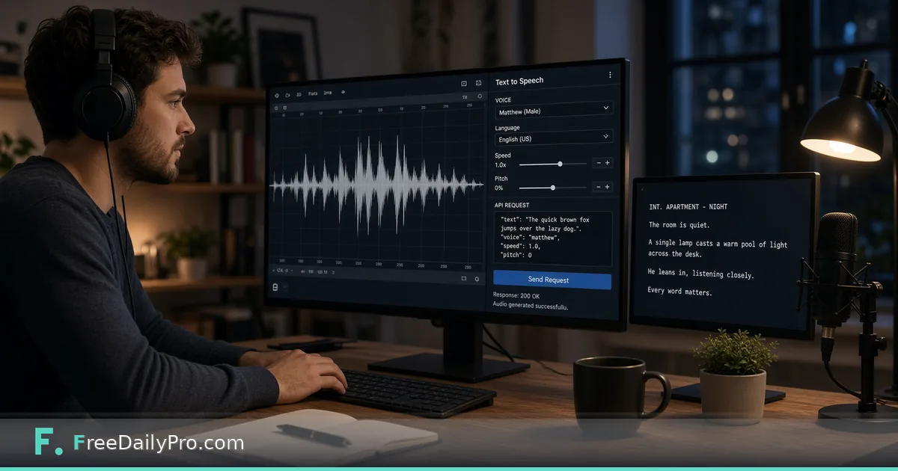

*Synthesize counts as 25 calls, trial keys get 20 synthesizes and 500 characters*

[FreeDailyPro.com](https://www.freedailypro.com) -- Jonah Park ships release notes as short audio for a product team in Seattle. The browser [Text to Speech](https://www.freedailypro.com/tool/text-to-speech) tool is perfect for one-off downloads. The speech API is what he needs when a build pipeline must speak a string and store an MP3 without a person clicking Export. The limits are different from a normal JSON call, and that is the whole point of this post.

This guide covers one job only: list voices, synthesize a short script, and plan quota using the live weighted-call rules.

## Two endpoints

From the live OpenAPI surface:

- `POST /v1/speech/voices` — lists voices, formats, limits for your key, and the synthesize weight. Counts as **one** call. Requires an API key.
- `POST /v1/speech/synthesize` — returns the audio file (MP3 by default, or WAV). Requires an API key; there is no key-less synthesize path.

Voices today: **amy**, **lessac**, and **ryan** (American English) and **alba** (British). Speed range is 0.5 to 2. Headers on a successful synthesize include `X-Audio-Seconds`, `X-Voice`, `X-Characters`, and `X-Call-Weight`.

## Weighted calls in plain numbers

A normal utility call (word count, hash, validate) counts **1** against the monthly allowance. A synthesize call counts **`callWeight: 25`**. The voices response documents that number so your client does not guess.

Plans on [developers](https://www.freedailypro.com/developers) share one pool across REST and MCP:

| Plan | Price | Calls per month |
|------|-------|-----------------|
| Trial | $0 | 20,000 |
| Premium | $24 / month | 200,000 |
| Ultra | $69 / month | 750,000 |
| Mega | $129 / month | 2,000,000 + priority support |

Rough math on trial: 20,000 / 25 = **800** full-weight synthesize calls a month **if** you spent the whole pool on speech alone. In practice Jonah mixes validate and text calls, so he budgets speech separately.

### Trial key extras (important)

On a **trial key**, synthesize is tighter than the monthly pool story:

- **20 synthesize calls in total** (not 20 per month) — field `trialSynthesizeCalls` on the voices response.
- **Up to 500 characters** per synthesize request.
- Paid plans raise the per-request text cap to **2,000 characters**.

Listing voices still costs one ordinary call and is the right first request after you create a key.

## Worked example: release-note MP3 in CI

- Engineer: Jonah Park
- Text: “Version 2.4 is live. Password reset e-mails now expire in thirty minutes.”
- Voice: `amy`, format `mp3`
- Expectation: file on disk, headers show character count and call weight 25
- Browser twin: he still uses [Text to Speech](https://www.freedailypro.com/tool/text-to-speech) when a marketer wants a one-off without keys

```bash
curl -X POST https://api.freedailypro.com/v1/speech/synthesize \
  -H "X-API-Key: YOUR_API_KEY" \
  -H "Content-Type: application/json" \
  -d '{"text":"Version 2.4 is live. Password reset e-mails now expire in thirty minutes.","voice":"amy","format":"mp3"}' \
  --output release-2-4.mp3
```

## Steps

1. Create a key on [developers](https://www.freedailypro.com/developers).
2. Call `/v1/speech/voices` and read `maxCharacters`, `callWeight`, and `trialSynthesizeCalls` if present.
3. Keep scripts under the character cap for your key.
4. POST `/v1/speech/synthesize` with `text`, `voice`, and optional `format` (`mp3` or `wav`).
5. Save the binary body; read `X-Call-Weight` to confirm 25.
6. For longer scripts, split under the character cap and join files with [Audio Merger](https://www.freedailypro.com/tool/audio-merger) or your own tool chain. [Audio Converter](https://www.freedailypro.com/tool/audio-converter) helps when a publisher demands a different container.
7. Browse [audio tools](https://www.freedailypro.com/category/audio-tools) for human-side editing after the API returns a file.

## Browser tool vs API

| Need | Use |
|------|-----|
| One download, no key | Browser [Text to Speech](https://www.freedailypro.com/tool/text-to-speech) (server voices, MP3/WAV, up to about 3,000 characters per file on the tool page) |
| CI / backend / agent | `/v1/speech/synthesize` with key and weighted quota |
| Device voices only, no file | Text Read Aloud on the site (different product behavior; no saved file) |

Do not assume browser character limits and API trial character limits are the same number.

## Common mistakes

- Surprising finance when 40 narrations consumed 1,000 call units (40 × 25).
- Burning the **20 trial synthesizes** on throwaway tests with 500-character lorem.
- Omitting the API key and expecting the public “try it now” word-count playground rules to apply—synthesize needs a key.
- Sending speed outside 0.5–2 or an unknown voice name.
- Forgetting that MCP video/audio file tools use **smaller** size limits than REST; speech synthesize returns audio bytes over REST in the example above.

## Limits and good to know

- Synthesize is processed in memory; the OpenAPI text states nothing is stored.
- Shared monthly pool with every other endpoint and MCP tool.
- FreeDailyPro offers 200+ professional tools in the browser for non-API work.
- Overview context: [API and MCP server-side tools](https://www.freedailypro.com/blog/api-mcp-server-side-tools).

## Planning a podcast-style batch

Jonah scripts a nightly job that speaks at most five short strings. He checks remaining trial synthesizes during beta by tracking a counter in his own database—the platform trial synthesize cap is total, not monthly. After upgrade to a paid plan, he still multiplies job size by 25 when comparing to the monthly call ceiling.

## FAQ

**Why does one MP3 cost 25 calls?**
Speech synthesis is heavier than a checksum or word count. The API documents `callWeight: 25` so billing is predictable.

**How many trial synthesizes do I get?**
20 total on a trial key, with up to 500 characters each, per the voices response fields.

**Can I use the same key for MCP?**
Yes. REST and MCP share the key and the monthly call pool.

## Closing next step

Weighted calls only surprise teams that never read the voices payload. Open [developers](https://www.freedailypro.com/developers), call `/v1/speech/voices`, then synthesize one sentence to `amy` and confirm `X-Call-Weight` is 25.

If you want a sample split-and-merge script for long narrations next, write to [https://www.freedailypro.com/contact](https://www.freedailypro.com/contact).
