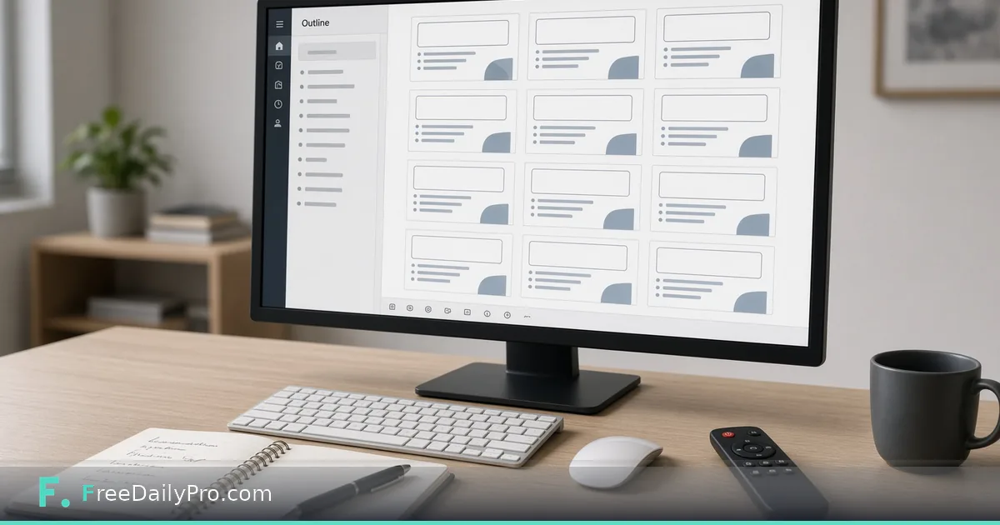

*Title, theme and seven slide kinds—your words only, exported as a real .pptx*

[FreeDailyPro.com](https://www.freedailypro.com) -- Priya Sen prepares quarterly updates for a nonprofit board in Minneapolis. She already has the outline in a notebook; she does not want a tool that invents copy. [Slide Deck Maker](https://www.freedailypro.com/tool/slide-deck-maker) is the Premium application that builds a complete PowerPoint (`.pptx`) from what **you** type—in three steps: title/look/layout, then slides, then export—using real title and body placeholders.

This guide covers one job only: turn a finished outline into a clean deck without auto-written bullets.

Browse [design tools](https://www.freedailypro.com/category/design-tools) for related presentation helpers.

## What the maker is (and is not)

Live product facts:

- Three steps: (1) title, subtitle, presenter, one of three layouts, look or brand colour/fonts; (2) slides—seven kinds, text you type, pictures with alt text, speaker notes; (3) export.
- **Nothing is written for you.** Slides contain exactly your words. Long lists shrink to fit with a warning when they may still overflow.
- Real placeholders so Outline view, Slide Master and Reuse Slides work in PowerPoint.
- Brand: choose Your brand colour and two fonts, or colours/fonts from [Brand Kit](https://www.freedailypro.com/tool/brand-kit) / [Brand Studio](https://www.freedailypro.com/tool/brand-studio) when available in-tab. Fonts are saved **by name**—use Calibri, Arial or other fonts the presenting computer has.
- Up to **60 slides**. Keep about six short points per slide; use section slides to separate parts.
- After export, finish size/numbers/watermark/clean/compress in [Presentation Studio](https://www.freedailypro.com/tool/presentation-studio).

Premium: **2 trial uses a day**; **$3 day pass** or **$9.99 a month**.

## Worked example: Q4 board outline

- Author: Priya Sen
- Outline: title, three section breaks, six content slides, one big-number slide, closing ask
- Brand: nonprofit teal + Arial/Georgia names she knows are on the board laptop
- Notes: speaker notes hold the script; slides stay sparse

Priya times herself: if building the deck takes longer than polishing the outline, the outline was not ready.

## Steps

1. Open [Slide Deck Maker](https://www.freedailypro.com/tool/slide-deck-maker) and confirm Premium access.
2. Step 1: enter title, subtitle, presenter; pick layout and look or brand colours/fonts.
3. Step 2: add slides by kind (bullet list, two columns, big statement, section, and the other kinds offered). Paste only the lines you want seen.
4. Add pictures with **alt text** for every image.
5. Put spoken detail in **speaker notes**, not on the slide.
6. Watch for shrink warnings on long lists; split slides instead of cramming.
7. Export `.pptx`. Open once in PowerPoint/Keynote-compatible software to verify fonts.
8. Optional finish pass in [Presentation Studio](https://www.freedailypro.com/tool/presentation-studio) before e-mail.

## Outline hygiene that survives the boardroom

Priya writes the outline offline first. Each slide in the notebook maps to one slide kind. She refuses to invent content inside the tool under time pressure—empty speaker notes beat fake bullets.

She labels notebook pages with the intended slide kind (`section`, `two-col`, `big-number`) so Step 2 is mechanical, not creative under stress.

## Picture and chart practice

She exports charts from her spreadsheet as PNG, imports them, and writes alt text that states the trend in one sentence. Decorative photos get short alt text too. Charts stay simple: one message per image. If a chart needs a full table, she puts the table in the appendix PDF, not on the slide.

## Font and brand discipline

Fonts are names only. If the board laptop lacks a fancy display font, titles fall back and the deck looks broken on presentation day. Priya sticks to Arial and Georgia for external board meetings. Internal staff meetings can use Brand Kit fonts when every machine has them installed.

Brand colour is one strong accent, not a rainbow. Section slides use the accent bar; body slides stay calm.

## Common mistakes

- Expecting the tool to draft strategy language.
- Picking exotic fonts missing on the presentation laptop.
- Skipping alt text on charts pasted as images.
- Sixty slides of dense paragraphs.
- Putting the entire script on the slide instead of in speaker notes.
- Exporting once and never opening the file on the actual presentation computer.

## Limits and good to know

- Premium trial/pricing as above.
- Seven slide kinds, three layouts, 60-slide cap.
- FreeDailyPro offers 200+ professional tools.
- Studio is for finishing an existing `.pptx`, not for authoring from outline.
- Speaker notes travel with the file; strip them in Presentation Studio before a public handout if needed.

## Scenario: five-slide donor update

1. Title with event name and date.
2. Big-number slide for funds raised.
3. Two-column impact stories.
4. Bullet list of next quarter priorities.
5. Closing ask with contact line in notes.

Priya builds this in one sitting because the outline already had five boxes. She spends more time choosing the photo for the impact slide than typing bullets.

## Scenario: training deck with many section breaks

A staff training outline has eight modules. She inserts a section slide before each module so presenters can jump in Outline view. Module content stays at four bullets max. Exercises live in a separate handout PDF, not in the slide body.

## After export: the finish lane

Size, numbers, draft watermark, clean for sharing, and compress belong in Presentation Studio. Priya never emails a 40 MB deck full of raw camera images. She compresses after export and keeps the master with full-resolution images offline.

## FAQ

**Does Slide Deck Maker write my slides?**
No. You type every word. It supplies layout, theme and structure.

**Can I use brand colours?**
Yes—manual brand colour/fonts or Brand Kit integration when offered.

**What file do I get?**
A real `.pptx` with standard placeholders.

**How many slides can I make?**
Up to 60. Prefer fewer, clearer slides for live delivery.

**Where do speaker notes go?**
In the notes field per slide. They are for the presenter, not the screen.

**What if I already have a messy deck?**
Finish and clean it in Presentation Studio. Author new structure here from an outline.

## Closing next step

Decks fail when the tool invents tone. Open [Slide Deck Maker](https://www.freedailypro.com/tool/slide-deck-maker), build five slides from a real outline, and export once for a font check on the machine you will present from.

If you want a seven-kinds cheat sheet next, contact [https://www.freedailypro.com/contact](https://www.freedailypro.com/contact).
