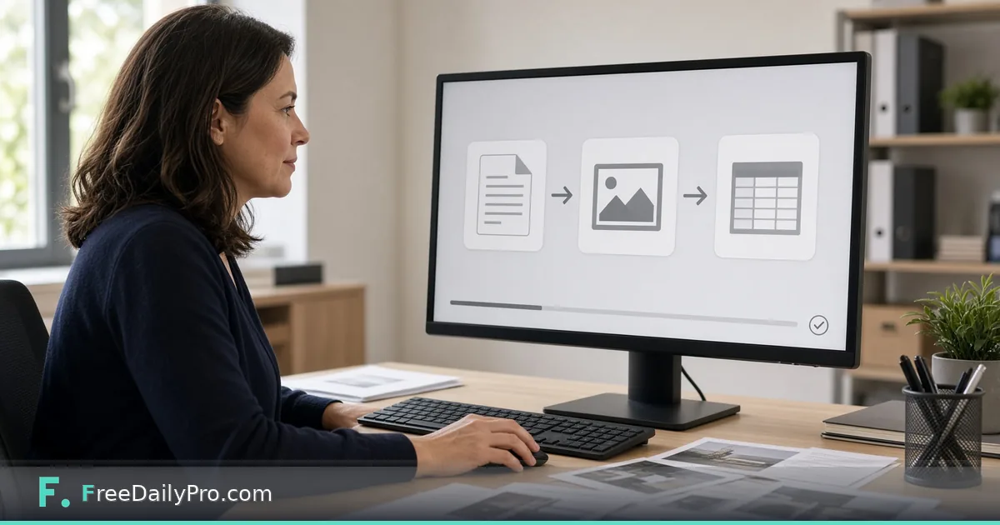

*Drop a file, see only the real targets, download the next stage without leaving the tab*

[FreeDailyPro.com](https://www.freedailypro.com) -- Marcus Hale is a freelance operations analyst in Columbus, Ohio. Client folders arrive as a mix of HEIC phone photos, scanned PDFs, Excel cost tables, and Word drafts. Opening a different single-purpose converter for each file used to burn half a morning. [Universal File Converter](https://www.freedailypro.com/tool/universal-file-converter) is the Premium application that accepts one file (or a small batch), shows **only formats that actually work**, and keeps each step as a downloadable stage in the browser.

This guide covers one job only: convert a realistic client packet in one Premium app without claiming video or audio routes the product does not offer.

## What it converts (and what it does not)

Live product scope: images (including HEIC), PDF, Excel/CSV, Word, PowerPoint, HTML, Markdown and text. **Not** video, audio, SVG, GIF or TIFF. That honesty is the product: the page only lists targets that really work.

Examples from the live tool:

- Image / HEIC → PDF, PNG, JPG, WebP, ICO, Base64 text, Text (OCR)
- PDF → JPG, Excel, Word, Text, HTML (routes reuse dedicated tool engines)
- Excel/CSV ↔ JSON / PDF / Word table paths where supported
- Text / Markdown / HTML routes into PDF or related document formats

For whole mixed folders with saved recipes, pair this Premium app with the workflow product [File Conversion Studio](https://www.freedailypro.com/tool/file-conversion-studio). For a handful of photos only, [Convert Image](https://www.freedailypro.com/tool/convert-image) stays a light Professional option. Dedicated [PDF to Word](https://www.freedailypro.com/tool/pdf-to-word) remains available when that single lane is enough.

Browse [file tools](https://www.freedailypro.com/category/file-tools) for siblings.

## Worked example: Friday client packet

- Operator: Marcus Hale
- Files: three HEIC site photos, one PDF report, one Excel cost sheet
- Goals: photos → JPG for the portal; PDF → Word for edits; Excel → JSON for a script
- Success: each conversion is a stage with its own Download button; originals remain available

Marcus names downloads by stage (`site-01.jpg`, `report-v1.docx`, `costs.json`) so the client portal never receives a file still titled `IMG_4321.HEIC`. He keeps the original HEIC and PDF in a separate archive folder so he can re-branch later without re-requesting files from the client.

## Steps in Universal File Converter

1. Open [Universal File Converter](https://www.freedailypro.com/tool/universal-file-converter) and confirm Premium access (2 trial uses a day; after trial, $3 day pass or $9.99 a month as shown on the tool).
2. Drop one file first. Read the target list—only real options appear.
3. Pick the target and run the conversion. Use on-tool edits (crop, resize, rotate, watermark where offered for that type) on the current stage if needed.
4. Download the stage you need. Stages stack: Original, then each conversion/edit.
5. For up to 20 files, switch to multi-file mode, set Convert all to or pick per-file targets, then download singles or a zip (or merge to one PDF when that option applies).
6. For Excel → JSON, ensure the first row is field names (remove title rows above headers).
7. For PDF → Excel, remember this path reads **real text-layer tables**, not OCR of a scan. A pure scan may report no tables found—use OCR routes first when needed.
8. Close the tab when finished. Conversion runs in the browser; files are not uploaded for converting (OCR language data may download once for Text OCR).

## Premium vs one-off Professional tools

Universal File Converter is a **Premium application**: **2 trial uses a day**, then a **$3 day pass** or **$9.99 a month**. Professional single-task tools separately show **10 trial usages** a day. File Conversion Studio is a **workflow product** ($29.99/mo class) for recipe-driven mixed folders. Do not mix those trial stories in client emails.

When Marcus only needs three JPGs from phone photos, he sometimes uses Convert Image on a Professional trial day to save Premium uses for the PDF→Word and Excel→JSON steps that matter more.

## Stage discipline Marcus uses

He always downloads Original once into an archive folder, then works only on named stages (`report-v1.docx`). If a client asks for the photo as both JPG and PDF, he branches two stages from the same HEIC instead of re-uploading. Stage names double as a short audit trail when a client asks “which version did you send?” two weeks later.

## Multi-file batch without chaos

When twenty files arrive, he groups by type first: images together, PDFs together. He runs Convert all to JPG for photos, then handles PDFs one by one so Word vs Excel choices stay intentional. A single zip of results goes to the client portal; the stage list stays on his machine.

He refuses to run Convert all on a mixed folder of photos and contracts in one click—wrong targets cost more time than sorting first.

## HEIC reality check for client portals

Many portals still reject HEIC. Marcus converts to JPG (or PDF when a multi-page scan is required) and checks orientation after conversion. Phone photos taken upside-down stay wrong until he uses rotate on the image stage. He also trims borders when a client photographed a whiteboard through a doorway frame.

## OCR text path when the PDF is a photo of a page

If the PDF is really a photo of a printed page, PDF→Word will not invent a clean text layer. Marcus uses the Text (OCR) path on the image/PDF route the tool offers, pastes the result into a draft, and corrects proper names by hand. He never promises the client “perfect OCR” for faded thermal receipts.

## Common mistakes

- Expecting MP4 or MP3 conversion here—use the dedicated video/audio tools instead.
- Forcing PDF→Excel on a scanned brochure with no table structure.
- Leaving a title row above Excel headers before JSON export.
- Burning both Premium trial uses on throwaway tests of the same PDF.
- Treating whiteout-style edits inside image stages as redaction for secrets—use proper redaction tools for sensitive PDF text.
- Re-uploading the same HEIC three times instead of branching stages.

## Limits and good to know

- Premium: 2 trial uses a day; $3 day pass or $9.99 a month (live tool page).
- Files stay on device for conversion; not a server document vault.
- FreeDailyPro offers 200+ professional tools beyond this app.
- Existing overview post [universal-file-converter](https://www.freedailypro.com/blog/universal-file-converter) covers capability map; this post is the **packet workflow** angle.
- Multi-file mode is for small batches (up to about 20), not a 2,000-file server farm job.

## Scenario: Monday morning three-file triage

1. HEIC photo of a signed delivery note → JPG for the ticket system.
2. PDF cost summary with a real text table → Excel for finance.
3. Markdown status notes → PDF for the weekly archive.

Marcus finishes all three inside Universal File Converter before coffee cools. He does not open desktop Word or Excel until a human edit is required after conversion.

## Scenario: JSON handoff for a script

The client wants costs as JSON. Marcus opens the Excel sheet, deletes the two marketing banner rows above the real headers, renames columns to snake_case, saves, then Excel→JSON. The script receives clean keys. He keeps the cleaned Excel as a stage so finance can still open a spreadsheet.

## FAQ

**Does Universal File Converter upload my files?**
Conversion runs in the browser. Files are not uploaded for converting. OCR language data may download the first time Text OCR runs.

**Can it convert video or audio?**
No. Use the dedicated media tools. This app covers documents, images, Office, HTML, Markdown and text.

**How is pricing different from Professional tools?**
This is Premium: 2 trial uses a day, then $3 day pass or $9.99 a month. Professional tools use the 10 trial usages model.

**When should I use File Conversion Studio instead?**
When you repeat the same mixed-folder recipe every week and want a workflow desk rather than one-off packet work.

**Will PDF→Word preserve every layout pixel?**
No. Expect editable structure, not a print-perfect twin. Complex multi-column magazine layouts need manual cleanup.

**What about password-protected PDFs?**
Unlock or remove the password first with the appropriate PDF tools, then convert. Universal File Converter is not a password cracker.

## Closing next step

One packet should not require six bookmarks. Open [Universal File Converter](https://www.freedailypro.com/tool/universal-file-converter), convert one real client file end to end, and keep the stage downloads beside the original.

If you want a HEIC-to-portal checklist next, ask at [https://www.freedailypro.com/contact](https://www.freedailypro.com/contact).
