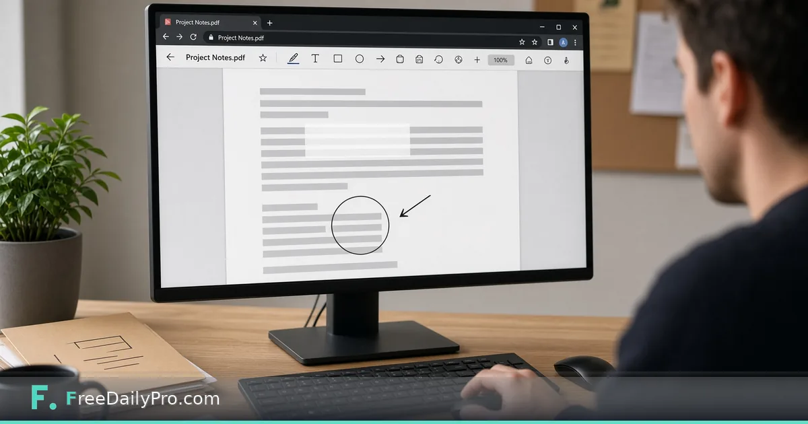

*Annotate pages with text, highlights, drawings and white patches—without desktop software*

[FreeDailyPro.com](https://www.freedailypro.com) -- Dana Ortiz reviews vendor contracts for a regional clinic group in Tampa, Florida. Reviewers need dates circled, typos corrected on printed lines, and non-sensitive notes added before the next meeting. [PDF Editor](https://www.freedailypro.com/tool/pdf-editor) is the Premium application that adds text, freehand drawing, rectangle and ellipse outlines, highlight boxes, white patches and pictures onto PDF pages entirely in the browser.

This guide covers one job only: mark up a review PDF correctly—and never confuse whiteout with true redaction.

## What PDF Editor does

From the live product:

- Add text, freehand marks, shapes (rectangle and ellipse outlines), highlight boxes, white patches, and inserted pictures (PNG/JPEG logos or stamps).
- **Edit text** mode: click a line of existing page text, retype it; the new words are drawn in a standard font over a white patch covering the old line. The **old words remain in the file** and can still be found by search.
- Whiteout **covers**; it does **not** delete. For confidential removal use [Redact PDF](https://www.freedailypro.com/tool/redact-pdf).
- Signatures belong in [Sign PDF](https://www.freedailypro.com/tool/sign-pdf). Real fillable fields belong in [Create Fillable PDF](https://www.freedailypro.com/tool/create-fillable-pdf) or [Fillable Forms](https://www.freedailypro.com/tool/fillable-forms).

Everything, including page previews, runs in the browser; the PDF is not uploaded.

Browse [pdf tools](https://www.freedailypro.com/category/pdf-tools).

## Worked example: vendor agreement review pack

- Reviewer: Dana Ortiz
- File: 18-page services agreement PDF
- Tasks: fix one printed date line, highlight three obligation paragraphs, circle a missing exhibit reference, whiteout a draft watermark area that is not confidential, add a small approved-stamp PNG
- Not tasks: remove patient-adjacent open text (that goes to Redact PDF)

Dana saves the annotated download as `Vendor-X-Review-2026-11-13.pdf` and never overwrites the counsel master. Counsel keeps an unannotated copy in the matter folder.

## Steps

1. Open [PDF Editor](https://www.freedailypro.com/tool/pdf-editor). Confirm Premium access: **2 trial uses a day**; then **$3 day pass** or **$9.99 a month**.
2. Drop the PDF. Move between pages with toolbar arrows.
3. Use **Select** to move or restyle an annotation you already placed.
4. Use **Edit text** for a single line of printed text: click, retype, keep length close so it does not collide with neighbors.
5. Add highlights, shapes, freehand or whiteout as needed. Insert a picture stamp when branding a review copy.
6. Download the annotated PDF. Open it in a second viewer and search for any string you only “covered” with whiteout—confirm it is still searchable if that matters.
7. For secrets, stop and switch to [Redact PDF](https://www.freedailypro.com/tool/redact-pdf) instead of whiteout.

## Whiteout vs redaction (non-negotiable)

| Need | Tool |
|------|------|
| Cover a non-sensitive draft note for a cleaner screenshot | PDF Editor whiteout |
| Permanently remove SSNs, account numbers, names | [Redact PDF](https://www.freedailypro.com/tool/redact-pdf) |
| Place a signature | [Sign PDF](https://www.freedailypro.com/tool/sign-pdf) |
| Add real form fields | [Create Fillable PDF](https://www.freedailypro.com/tool/create-fillable-pdf) |

Dana’s rule: if legal discovery could ask for the underlying text, whiteout is the wrong tool. She teaches new staff with a live demo: whiteout a word, download, search—the word still appears. Redact the same word, search—it is gone.

## Reviewer workflow Dana teaches

First pass: shapes and highlights only—no whiteout. Second pass: Edit text for obvious typos on printed lines. Third pass: stamp and export. Sensitive removals are a separate Redact PDF ticket with a second person check.

She prints a one-page checklist for contractors who only review twice a year so they do not invent their own markup style.

## Picture stamps without clutter

She keeps one PNG “Reviewed” stamp at a fixed size and places it once on the signature page, not on every leaf. Too many stamps look unprofessional and bloat the file. Logo stamps stay semi-transparent when the tool allows so underlying text stays readable in screenshots.

## Edit text without wrecking layout

Edit text is for short printed lines: a date, a room number, a single misspelled word. Dana never tries to rewrite a full paragraph with Edit text. Long rewrites belong in Word after a PDF→Word conversion, or in a new PDF version from the source system.

When replacement text is longer than the original line, she shortens the wording instead of letting the overlay spill into the next column.

## Common mistakes

- Using Edit text as if it rewrote the PDF content stream—it overlays a patch.
- Whiteouting confidential clauses.
- Filling complex AcroForm fields with plain annotation text boxes instead of using Fillable Forms.
- Expecting multi-line reflow like a word processor.
- Annotating the only master file without a backup.
- Circling so aggressively that the PDF looks unreadable in black-and-white printouts.

## Scenario: board packet markup overnight

Dana receives a 40-page packet at 6 p.m. She highlights only the three motions that need a vote, circles the budget table total, and adds a one-line text note “confirm insurance rider.” She does not rewrite financial tables inside PDF Editor. Finance owns the source spreadsheet.

## Scenario: marketing PDF with a wrong phone number

A printed brochure PDF shows an old phone number. Marketing needs a quick fix for tomorrow’s print house. Dana uses Edit text on that line, keeps the length similar, downloads, and has a second person verify the number against the CRM. Permanent brand fixes still go back into the design file later.

## Limits and good to know

- Premium: 2 trial uses a day; $3 day pass or $9.99 a month.
- Browser-only processing; not uploaded.
- FreeDailyPro offers 200+ professional tools.
- Replacement text uses a standard font; complex scripts may not match the original typeface.
- Large scanned image-only PDFs may feel slower to page through; compress or split first when needed.

## Collaboration habit

She names annotation colours by role when multiple people mark the same PDF outside the tool (yellow = legal, blue = ops). Inside PDF Editor she still exports one reconciled copy so the vendor never sees three competing markups.

## FAQ

**Can PDF Editor rewrite the document body like Word?**
No. It adds annotations and line-level overlay edits. It does not reflow paragraphs.

**Is whiteout safe for confidential data?**
No. Covered text can still be searched. Use Redact PDF.

**Does my PDF leave the device?**
No. Editing runs in the browser.

**Can I sign inside PDF Editor?**
Use Sign PDF for signatures. PDF Editor is for markup and light text patches.

**What about fillable forms?**
Create fields with Create Fillable PDF; fill existing fields with Fillable Forms. Do not fake fields with rectangles alone.

**Will highlights survive print?**
Usually yes as graphic annotations, but test one page on the office printer before a board meeting.

## Closing next step

Markup fails when cover-up is mistaken for removal. Open [PDF Editor](https://www.freedailypro.com/tool/pdf-editor), annotate one non-sensitive review PDF, then run a search test on anything you whiteouted.

If you need a redact-vs-whiteout training one-pager next, contact [https://www.freedailypro.com/contact](https://www.freedailypro.com/contact).
