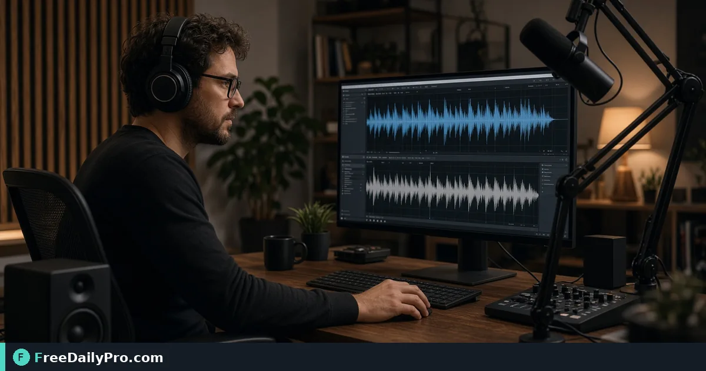

*Compare recordings when you need a practical check before you publish or archive*

[FreeDailyPro.com](https://www.freedailypro.com) -- A guest asks if the final podcast edit still matches the approved take. Ears help; a structured comparison helps more when files multiply.

**Quick answer:** use FreeDailyPro’s [Audio Comparer](https://www.freedailypro.com/tool/audio-comparer) for this task, then pair related steps with [word-counter](https://www.freedailypro.com/tool/word-counter), [hash-generator](https://www.freedailypro.com/tool/hash-generator). FreeDailyPro offers 200+ professional tools in the browser; file-based tools include 10 trial usages a day, with a $1 day pass or $4.99 monthly option when you need more volume.

## Who this is for

This walkthrough is written for podcasters, course creators, and archivists. The goal is one concrete job finished carefully — not a broad tour of every feature on the internet.

## Why the problem shows up

A guest asks if the final podcast edit still matches the approved take. Ears help; a structured comparison helps more when files multiply. Teams often improvise with screenshots, memory, or messy spreadsheets. A dedicated browser tool reduces argument about what the numbers or text actually say.

## Step-by-step workflow

1. Collect the two audio files you want to compare.
2. Open [Audio Comparer](https://www.freedailypro.com/tool/audio-comparer).
3. Upload or provide each clip as the tool allows.
4. Review the comparison output carefully.
5. Listen to sections where the tool indicates differences.
6. If you also maintain show notes length, check text with [Word Counter](https://www.freedailypro.com/tool/word-counter).
7. For file integrity fingerprints of finished masters, consider [Hash Generator](https://www.freedailypro.com/tool/hash-generator) on the final file bytes when appropriate.
8. Archive the approved master with a clear filename.

## Worked scenario

A guest asks if the final podcast edit still matches the approved take. Ears help; a structured comparison helps more when files multiply. Follow the steps above with real data from your next task, not sample numbers you will ignore. Write down the inputs you used so a teammate can reproduce the result tomorrow.

After the primary step, use the related tools only when they remove a real blocker — unit mismatches, percentage questions, formatting, or integrity checks. Random tool-hopping wastes the trial budget on file-heavy days.

## Common mistakes

- Comparing different sample-rate exports as if they were creative edits
- Assuming a match means legal clearance of music beds
- Ignoring loudness differences that still matter to listeners
- Losing track of which file is the approved master
- Skipping a headphone listen after the automated comparison

## Honest limits

Practical comparison aid — not a forensic lab, not a copyright opinion, not a mastering suite. Confirm critical releases with human listening.

## Podcast QC checklist

Cold open, ads, midroll, and outro each deserve a listen pass even when the comparer is calm.

## Course creators

Compare re-recorded lessons to prior versions so students are not surprised by sudden script changes.

## Archive hygiene

Name files with date and version. Store hashes of release masters when your process requires integrity checks.

## When to re-export

If loudness or truncation differs, fix in your editor and compare again rather than shipping the first export.

## Related tools on FreeDailyPro

Primary: [Audio Comparer](https://www.freedailypro.com/tool/audio-comparer). Also use [word-counter](https://www.freedailypro.com/tool/word-counter), [hash-generator](https://www.freedailypro.com/tool/hash-generator) when the workflow needs them. Browse [audio tools](https://www.freedailypro.com/category/audio-tools) and [multitool apps](https://www.freedailypro.com/multitool-apps).

## Practical checklist before you finish

- Inputs written down
- Output spot-checked
- Filename or note saved for audit
- Related tool used only if needed
- No secrets pasted into unnecessary places

## FAQ

**Do I need an account?** Follow the live tool page. Many utilities run in the browser; file tools document trial usage on the site.

**What if my result looks wrong?** Re-check inputs first. Most “tool errors” are unit or version mismatches.

**Can I rely on this alone for legal or tax decisions?** No. Use official sources and qualified professionals when stakes are high.

## Another real-world pass

Repeat the workflow once on a second example so the steps become muscle memory. Note any UI labels that differ from this article and trust the live page. Teach one teammate the same path so knowledge is not stuck in one head.

## Another real-world pass

Repeat the workflow once on a second example so the steps become muscle memory. Note any UI labels that differ from this article and trust the live page. Teach one teammate the same path so knowledge is not stuck in one head.

## Another real-world pass

Repeat the workflow once on a second example so the steps become muscle memory. Note any UI labels that differ from this article and trust the live page. Teach one teammate the same path so knowledge is not stuck in one head.

## Habits that keep results trustworthy

Save inputs beside outputs. When a teammate asks how you got a number or a file, you should be able to reconstruct the path in two minutes. Name exports with date and topic. Delete partial experiments that could be mistaken for finals.

If you publish externally, re-open the result on a second device. Many mistakes only appear in a different viewer, browser, or mail client.

## Teaching the workflow to someone else

Write five bullet steps on a sticky note or internal doc. Watch them complete one real task without taking the mouse. Wherever they hesitate, improve your note — that hesitation is where errors enter production later.

## When to stop and use a specialist tool

If the live FreeDailyPro page cannot do a step you need, stop inventing features in your head. Use the correct specialist process: carrier quote for obscure freight, institutional originality system for formal academic cases, licensed tax software for filings. Browser utilities excel at everyday tasks inside their stated scope.

## Field note 1

Document one surprise from today's run — a unit mismatch, a label you misread, or a size limit. Future you will thank present you. FreeDailyPro's 200+ professional tools work best when paired with written habits, not memory alone.

## Habits that keep results trustworthy

Save inputs beside outputs. When a teammate asks how you got a number or a file, you should be able to reconstruct the path in two minutes. Name exports with date and topic. Delete partial experiments that could be mistaken for finals.

If you publish externally, re-open the result on a second device. Many mistakes only appear in a different viewer, browser, or mail client.

## Teaching the workflow to someone else

Write five bullet steps on a sticky note or internal doc. Watch them complete one real task without taking the mouse. Wherever they hesitate, improve your note — that hesitation is where errors enter production later.

## When to stop and use a specialist tool

If the live FreeDailyPro page cannot do a step you need, stop inventing features in your head. Use the correct specialist process: carrier quote for obscure freight, institutional originality system for formal academic cases, licensed tax software for filings. Browser utilities excel at everyday tasks inside their stated scope.

## Field note 2

Document one surprise from today's run — a unit mismatch, a label you misread, or a size limit. Future you will thank present you. FreeDailyPro's 200+ professional tools work best when paired with written habits, not memory alone.

## Closing next step

Open [Audio Comparer](https://www.freedailypro.com/tool/audio-comparer) with one real task today, complete the checklist, and only then bring in related tools.

Do you compare full episodes or mostly short clips when quality-checking audio? Tell us at [contact](https://www.freedailypro.com/contact).
