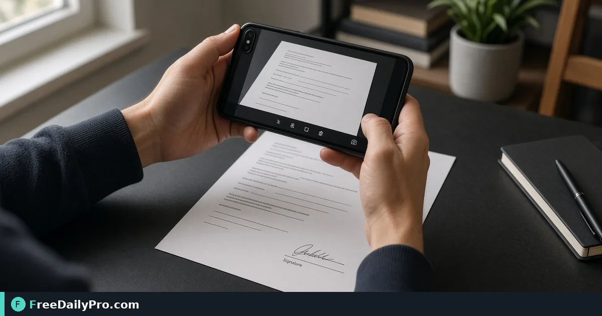

*Capture forms with your phone workflow, then move cleanly into PDF when needed*

[FreeDailyPro.com](https://www.freedailypro.com) -- The form is on paper. The portal wants a file. A full desk scanner is three rooms away—or you do not own one. A careful phone capture plus a browser document tool is enough for many everyday forms.

## Quick answer

Use [Document Scanner](https://www.freedailypro.com/tool/document-scanner) to capture or refine a paper page into a usable image. Stack pages with [Image to PDF](https://www.freedailypro.com/tool/image-to-pdf). Shrink with [Compress PDF](https://www.freedailypro.com/tool/compress-pdf) when upload caps appear. Image and PDF tools are part of 200+ professional tools on FreeDailyPro.

## Capture habits that save rework

Flat surface, even light, no harsh shadow from your hand. Align edges. Avoid glittery lamination glare. One page per capture when possible so order stays obvious. Turn off heavy beauty filters on the camera. You want readable text, not a soft social photo.

## Numbered workflow

1. Place the page flat; hold the camera directly above.
2. Open [Document Scanner](https://www.freedailypro.com/tool/document-scanner) and follow the on-page controls for capture or upload as shown on the live tool.
3. Review contrast and crop so text is readable at 100% zoom.
4. Save the cleaned image with a clear name such as 2026-tax-w9-page1.jpg.
5. For multi-page sets, convert ordered images with [Image to PDF](https://www.freedailypro.com/tool/image-to-pdf).
6. If the portal rejects file size, run [Compress PDF](https://www.freedailypro.com/tool/compress-pdf) and re-open to confirm text still reads.

See [image tools](https://www.freedailypro.com/category/image-tools) and [pdf tools](https://www.freedailypro.com/category/pdf-tools).

## Multi-page paper stacks

Staple removal helps flatness. Capture in page order. If a page is double-sided, capture both sides as separate images and label them clearly before building the PDF. Keep a simple checklist for long packets so page 7 does not vanish.

## When scanning is the wrong tool

Blurry carbon copies, tiny footnotes, or legal exhibits that need certified copies may require a proper scanner or a notary process. Do not pretend a phone photo is a certified original.

## Common mistakes

- Skewed angles that bend lines of text.
- Multi-page packets in random gallery order.
- Over-compressing until signatures become mud.
- Submitting a photo of a screen instead of the paper.
- Fingers in the frame covering a clause.
- Using flash that washes out ink.

## Mini case

A renter must upload a signed addendum. Two pages on the kitchen table, midday window light, Document Scanner workflow, Image to PDF, one file named with the unit number. Upload succeeds under the portal size cap after a light compress.

A clinic front desk captures insurance cards front and back for a chart that only accepts PDF—two images, one packet.

## FAQ for paper capture

**Can I scan IDs?** Follow privacy law and company policy. Many orgs forbid storing ID images in personal drives. Use approved channels.

**What resolution is enough?** Readable text at 100% zoom on a laptop is the practical bar for forms. Archival projects may need stricter standards outside this tool.

**Double-sided cards?** Capture front and back as two images, label them, then build a two-page PDF.

**Wet ink?** Wait for signatures to dry so pages do not stick or smear in the photo.

## Honest limits

Browser scanning helps everyday paperwork. It is not a replacement for archival imaging standards in every industry. Confirm formats and limits on the live tool page. 10 trial usages a day; then $1 daily or $4.99 monthly if you need more. FreeDailyPro hosts 200+ professional tools—pick scanning for paper, not for every media type.

## Step-by-step for a school permission slip

1. Sign the paper with dark ink and let it dry.
2. Place the form on a dark table, four corners visible.
3. Photograph from directly above with even window light.
4. Open [Document Scanner](https://www.freedailypro.com/tool/document-scanner), crop to the page edge, straighten, and save PDF.
5. Open the PDF and zoom until you can read every field.
6. If the school portal has a small size cap, use [Compress PDF](https://www.freedailypro.com/tool/compress-pdf) once and re-check the signature.
7. If you have three forms, process each, then assemble with [Image to PDF](https://www.freedailypro.com/tool/image-to-pdf) or merge if already PDF.

Name the file with the child name and form type only if that matches your privacy practice at home; some families prefer student ID instead of full name in filenames.

## Desk kit that improves every scan

A dark non-reflective mat, a spare blank sheet under thin forms, and a clean phone lens. Wipe the lens before critical shots. Keep a paperclip to flatten corners. These props cost little and cut re-shoots.

## After the portal accepts the file

Delete intermediate photos that show full account numbers if you do not need them. Keep the accepted PDF in a school-year folder. Note the confirmation number in a plain text file next to it.

## Lighting and surface kit on a budget

You do not need studio gear. A matte dark desk reduces bounce. Daylight from the side beats overhead yellow bulbs for black text. If you must work at night, use two lamps at 45 degrees to cut glare on glossy forms.

A cheap clipboard keeps thin receipts flat. Tape corners lightly if wind or AC blows pages. Never tape over text.

## Building a repeatable scan desk

Create a small ritual: clear desk, place page, capture, name file, next page. Rituals beat memory when you have twenty pages of onboarding forms. A paper sticky with "page N of M" in the corner of the frame can help later sorting if filenames get confused—remove sticky for final legal copies if policy requires clean pages.

## Portal and compliance notes

HR and medical portals may reject photos that show clutter or other people's documents in the background. Frame tightly. Redact sticky notes with phone numbers that are not part of the form before you capture.

If your organization requires encryption at rest, move finished PDFs into the approved drive immediately and delete casual copies from the camera roll according to policy.

## Quality control loop

After each five pages, open the images at 100% and confirm the smallest footnote. Fix failures immediately while the paper is still on the desk. Re-finding page 12 in a stack wastes more time than a thirty-second check.

## Extra worked example

A small law office intake: ID policy forbids casual cloud uploads. Staff capture forms to local images via Document Scanner workflow, build PDFs, and place them only in the matter folder. Compress only when the matter system enforces size limits. Page order matches the intake checklist printed on the cover sheet image.

## Glare, lamination, and glossy certificates

Laminated award pages and glossy certificates bounce light. Angle the phone a few degrees, then straighten in [Document Scanner](https://www.freedailypro.com/tool/document-scanner). If a bright rectangle still covers a seal, re-shoot under softer light. Do not accept a scan where the seal is unreadable.

## Long forms that span two pages

Photograph each page separately with the same crop style. Keep headers visible so reviewers know page order. Assemble with [Image to PDF](https://www.freedailypro.com/tool/image-to-pdf) when you have multiple cleaned images. If the school wants one file per form type, do not merge unrelated forms into one giant PDF.

## Accessibility for older relatives

Parents helping grandparents with benefits paperwork should zoom the final PDF on a tablet and read fields aloud. If a date is ambiguous, re-shoot closer. The goal is acceptance on the first upload, not a minimal-effort photo.

## Browser and device notes

Use a current browser. If the camera upload fails, transfer the photo to the computer first, then upload from disk. FreeDailyPro’s Document Scanner is a MultiTool App designed for crop, straighten, rotate, and PDF save — confirm the on-page controls match what you need before a deadline day.

## Connecting to compression and packets

A beautiful scan that exceeds the portal limit still fails. After you are happy with readability, use [Compress PDF](https://www.freedailypro.com/tool/compress-pdf) only as far as needed. Browse [image tools](https://www.freedailypro.com/category/image-tools) and [PDF tools](https://www.freedailypro.com/category/pdf-tools) for neighboring steps in the same workflow family.

## Closing next step

Scan one real page with [Document Scanner](https://www.freedailypro.com/tool/document-scanner), then build a PDF if the destination requires it.

Which paper type still fails for you—glossy, thin receipts, or multi-page stapled packs? Reach out via [contact](https://www.freedailypro.com/contact).
