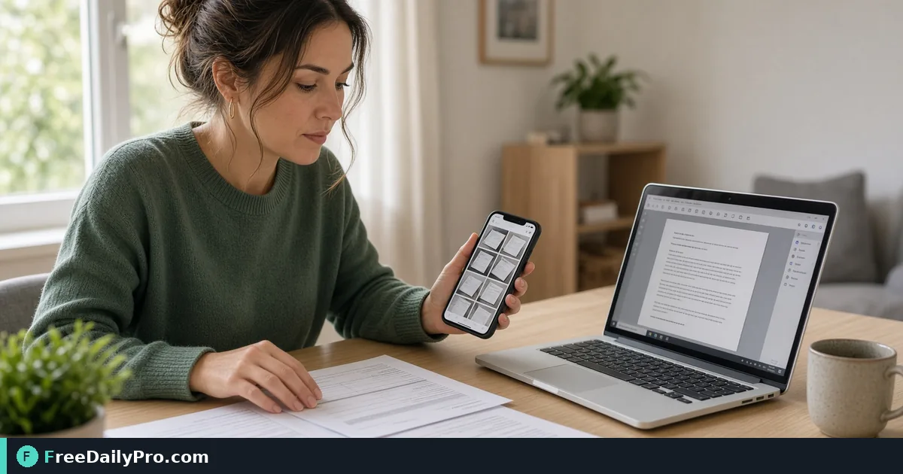

*Order scans and photos, build a single PDF, then compress if email limits hit*

[FreeDailyPro.com](https://www.freedailypro.com) -- A client asks for everything in one PDF, but your proof is six phone photos and two scans. Sending a photo album link is not what they meant. They want page order they can print.

## Quick answer

Use [Image to PDF](https://www.freedailypro.com/tool/image-to-pdf) to stack images in the right order into one document. If the file is too heavy for email, run [Compress PDF](https://www.freedailypro.com/tool/compress-pdf). If some pages already exist as PDF, combine with [Merge PDF](https://www.freedailypro.com/tool/merge-pdf). These PDF tools sit among 200+ professional tools on FreeDailyPro.

## Prep images before conversion

Shoot in good light. Crop edges so the document fills the frame. Rename files with numeric prefixes so order is obvious. Mixed HEIC and JPEG is common—convert stubborn formats before you build the packet if a browser cannot read them. Remove near-duplicate shots. Clients do not need five almost identical angles of the same receipt corner.

## Numbered workflow

1. Collect images in final order on disk.
2. Open [Image to PDF](https://www.freedailypro.com/tool/image-to-pdf).
3. Add files in order; confirm the preview sequence.
4. Export the PDF and open it full screen.
5. If size exceeds mail limits, use [Compress PDF](https://www.freedailypro.com/tool/compress-pdf) and re-check readability.
6. If you must insert an existing PDF page set, use [Merge PDF](https://www.freedailypro.com/tool/merge-pdf) after conversion.

Category hub: [pdf tools](https://www.freedailypro.com/category/pdf-tools). Also see [multitool apps](https://www.freedailypro.com/multitool-apps) if you keep a personal shortlist of daily tools.

## Client packet patterns

Receipts, signed forms photographed on site, warranty cards, damage photos with a cover sheet image first. Always put the summary page first so the reader knows what they hold. Insurance and landlord portals often reject multi-file uploads. One PDF with clear page order reduces back-and-forth.

## Orientation and page size

If a photo is sideways, rotate the source image before building the PDF when possible so every page reads without turning a phone. Mixed portrait and landscape is fine if each page is intentional. Avoid huge camera originals when a moderate resolution already reads well on screen and paper.

## Common mistakes

- Random phone gallery order with no renaming.
- Exporting huge camera originals when a moderate resolution already reads well.
- Compressing so hard that text on a photo becomes unreadable.
- Forgetting to check the PDF on mobile where many clients open it first.
- Leaving personal photos that were on the camera roll between work shots.
- Forgetting a cover image that states the job address or claim number.

## Mini case

A contractor has eight job-site photos plus one paper permit photo. Files renamed 01 through 09. Image to PDF builds a 9-page packet. Compress PDF brings it under a 10 MB mail cap. The subject line includes the job address so the office files it correctly.

A tutor scans three homework pages with a phone, builds one PDF, and returns feedback without a cloud album login for the parent.

## FAQ for photo packets

**Will quality survive email?** Moderate camera resolution usually survives light compression. Always open the compressed PDF and read the smallest text before sending.

**Color or grayscale?** Keep color for damage photos; grayscale can shrink forms if the portal allows it and stamps remain clear.

**Maximum pages?** Practical limits are email size and reader patience. Split huge sets with clear part labels rather than one giant unread file.

**Do I need OCR?** Only when someone must search text inside the PDF. Image-to-PDF alone keeps picture pages.

## Honest limits

Image-to-PDF is not a full scanner app with deskew for every angle, and it is not OCR by itself. If you need searchable text from photos, use a dedicated OCR tool after you have a clean PDF. Confirm behavior on the live tool page for your browser. You get 10 trial usages a day; heavier batches may need the $1 day pass or $4.99 month option.

## Step-by-step for a landlord repair packet

1. Photograph the leak, the damaged ceiling, and the work order signature page in bright light.
2. Rename on the phone as 01-leak, 02-ceiling, 03-signature so order survives gallery sort quirks.
3. Open [Image to PDF](https://www.freedailypro.com/tool/image-to-pdf) and add files 01 through 03.
4. Export and open the PDF on your phone to confirm orientation.
5. If email size fails, run [Compress PDF](https://www.freedailypro.com/tool/compress-pdf) once and re-check the signature page.
6. If the office also wants your prior PDF report attached, finish with [Merge PDF](https://www.freedailypro.com/tool/merge-pdf).

Write the unit number in the filename and in the email body. That single habit reduces “which property?” reply chains.

## When portals demand exact page counts

Some school systems require a fixed number of pages. If you have extra blank shots, remove them before conversion. If you are short a required reverse side, re-shoot rather than padding with an unrelated photo. Portal software often counts pages strictly.

## Team handoff inside a small office

One person captures, another assembles. Agree on naming before the job site visit. Store finished PDFs in a shared drive folder labeled by client and date. Do not leave final packets only inside a chat thread that auto-deletes.

## Naming and version control for packets

Treat each PDF like a deliverable, not a disposable export. Include date and subject in the filename: 2026-10-15_unit4B_damage-photos.pdf. When you revise, bump a version suffix rather than overwriting silently. Clients forward files; clear names reduce "which one is final" threads.

If legal or insurance reviews are involved, keep the original photos in a separate folder. The PDF is the presentation layer; originals are your evidence archive.

## Email and portal size tactics

Many mail systems stall around 10–25 MB. Compress before you hit send. If compress still fails the cap, split into part A and part B with an index page image that lists what is in each file. State the split in the email body so nobody thinks pages are missing.

Some portals accept only PDF/A or strip metadata. If a portal rejects your file, read the error once, then try a re-export after compress. Do not keep re-uploading the same giant original.

## Accessibility and readability checks

Open the PDF on a phone in bright light. If labels on photos are unreadable, reshoot or annotate the source images before converting again. For multi-language clients, put a one-line English or local-language summary on page one.

When you merge an existing PDF cover letter with photo pages, confirm page order in a PDF reader thumbnails pane, not only in the converter preview.

## Team handoff habits

Write a two-line note in the email: page 1 cover, pages 2–5 photos north wall, pages 6–7 permit. Reviewers skip guessing. Store the final PDF where the project already lives so the next person does not hunt chat history.

## Extra worked example

An apartment turnover: twelve photos of rooms, two of meter readings, one signed checklist photo. Rename 01–15. Build with Image to PDF. Compress once. Merge a one-page PDF inventory list created earlier if needed. Send under a subject with unit ID and date. Landlord confirms receipt without asking for a cloud link.

## Orientation, rotation, and mixed page sizes

Phone photos often flip depending on how you held the device. After export, scroll every page. If page 4 is sideways, fix it before the client sees it. Mixed landscape diagrams and portrait forms are fine when intentional; accidental rotation is not.

If one image is a wide whiteboard shot, decide whether it should be its own landscape page or cropped to the relevant region first. Blurry crops waste pages and patience.

## Email clients that rewrite attachments

Some webmail systems re-encode PDFs. If a recipient says the file “won’t open,” ask what app they use and resend a freshly exported copy. Keep the original export in your sent folder. Avoid renaming only the extension of a JPEG to .pdf — that is not a real PDF and confuses everyone.

## Checklist before you leave the job site

For field workers: confirm you captured the required number of angles, a wide establishing shot if needed, and a close-up of serial numbers. Build the PDF before you drive away while the scene is still available to re-shoot. Cellular upload can wait; missing photos cannot.

## How FreeDailyPro fits the wider PDF habit

[Image to PDF](https://www.freedailypro.com/tool/image-to-pdf) starts the packet. [Compress PDF](https://www.freedailypro.com/tool/compress-pdf) meets size caps. [Merge PDF](https://www.freedailypro.com/tool/merge-pdf) attaches existing digital forms. Together they cover the most common “photos plus paperwork” problem without installing a desktop suite. Explore the rest under [PDF tools](https://www.freedailypro.com/category/pdf-tools).

## Closing next step

Open [Image to PDF](https://www.freedailypro.com/tool/image-to-pdf) with three ordered photos from a real task and export one packet today.

What still breaks your photo-to-PDF routine—order, size, or mixed formats? Write us via [contact](https://www.freedailypro.com/contact).
