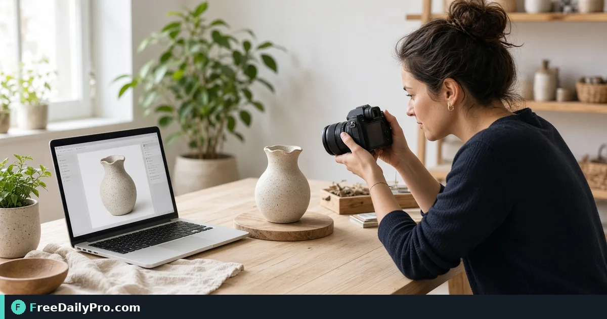

*Cut a subject cleanly for listings and avatars, then export at the size you need*

[FreeDailyPro.com](https://www.freedailypro.com) -- Marketplace listings and profile pages punish messy backgrounds. You do not always need a studio. You need a clean subject on transparent or plain white for the template you already use.

## Quick answer

Run the photo through [Remove Background](https://www.freedailypro.com/tool/remove-background), inspect hair and edges at zoom, export PNG when you need transparency. Capture UI references with [Screenshot Tool](https://www.freedailypro.com/tool/screenshot-tool) if you are documenting before and after for a client. Pack stills into PDF only when a client asks, using [Image to PDF](https://www.freedailypro.com/tool/image-to-pdf).

## What photos work best

Even light, subject separated from the wall, fewer tiny strands against busy patterns. Jewelry and mesh fabrics need a closer edge check after removal. Avoid heavy compression on the source before cutout. Start from the best file you have, then size down for the channel.

## Numbered workflow

1. Choose the sharpest product or portrait frame.
2. Open [Remove Background](https://www.freedailypro.com/tool/remove-background).
3. Upload and wait for the cutout preview on the live page.
4. Zoom edges: hair, logos on mugs, thin straps.
5. Export PNG for transparent use, or follow the tool export options for your target.
6. If you need a screen capture of the listing template, use [Screenshot Tool](https://www.freedailypro.com/tool/screenshot-tool).
7. For a PDF lookbook page of several cutouts, use [Image to PDF](https://www.freedailypro.com/tool/image-to-pdf).

Category: [image tools](https://www.freedailypro.com/category/image-tools).

## Marketplace reality

Some platforms re-compress uploads aggressively. Start from a clean cutout, then match their recommended pixel size. Do not upload a huge billboard PNG when the slot is 1000 px wide. White-background rules on some marketplaces still apply after cutout—place the subject on white in your listing editor if required.

## Profile and avatar use

Crop after removal so the face sits correctly in a circle avatar. Leave a little headroom. Check dark-mode sites where a transparent PNG might sit on black.

## Common mistakes

- Accepting the first cut without zooming.
- Leaving a gray halo on white products.
- Using a low-resolution phone crop as a hero image.
- Forgetting to keep the original photo when the cutout fails on a hard edge.
- Publishing internal screenshots that still show the messy studio floor in a corner.

## Mini case

A candle seller photographs three jars on a wooden table. Remove Background isolates each jar. PNGs drop onto a white template. One group PDF is sent to a wholesale buyer who asked for a one-pager—not a ZIP of raw camera files.

A consultant updates a conference bio photo: remove cluttered bookshelf, export PNG, drop onto a simple brand color.

## FAQ for cutouts

**PNG or JPEG after removal?** Prefer PNG when you need transparency. JPEG is fine after you place the subject on a solid background in your editor.

**Batch many SKUs?** Process in small groups so you can inspect edges. 10 trial usages a day may require planning or a day pass for large catalogs.

**Can I replace the background with a scene?** This tool focuses on removal. Scene composite is a separate design step in your editor of choice.

**Logo marks on products?** Zoom the logo edges; automatic tools sometimes shave thin lettering.

## Honest limits

Automatic cutouts struggle with motion blur, heavy smoke, and subjects that match the background color. Complex composites may still need a manual editor. FreeDailyPro lists 200+ professional tools; this one is for background removal, not full design suites. 10 trial usages a day; paid day or month options when you batch many SKUs.

## Step-by-step for a single SKU hero image

1. Place the product on plain paper near a window.
2. Shoot slightly above eye level with the product filling most of the frame.
3. Open [Remove Background](https://www.freedailypro.com/tool/remove-background) and process.
4. Download and place on a white 2000px canvas in your listing tool if the marketplace wants square white backgrounds.
5. Zoom to 200% and fix or re-shoot if edges bite into the product.
6. Save as `sku-hero-cutout.png` plus keep `sku-hero-original.jpg`.
7. Optional: build a three-image PDF lookbook with [Image to PDF](https://www.freedailypro.com/tool/image-to-pdf) for wholesale emails.
8. Optional: document your listing steps for a VA using [Screenshot Tool](https://www.freedailypro.com/tool/screenshot-tool).

## Seasonal catalog refresh

When seasons change, re-shoot hero products under the same light recipe so the whole shop matches. Batch removal in one afternoon. Reject cutouts that look inconsistent even if they are “good enough” alone — shoppers see the grid, not one image.

## Returns and disputes

Keep original uncut photos. If a buyer disputes color, the original under daylight is better evidence than a heavily processed cutout. Store both for ninety days after delivery when margins allow storage.

## Preparing shoots so cutouts succeed

Distance the subject from the wall to reduce shadow merging into the silhouette. Use a backdrop color that contrasts the product—light wood tables fight brown packaging. Wipe dust before the shot; dust becomes "detail" the cutout may keep as ugly speckles.

Shoot a safety frame with extra margin so tight crops still have room after edge cleanup.

## Listing templates and safe margins

Many marketplaces show your image in a card with rounded corners. Keep critical logos away from the extreme edge. After removal, place the subject slightly above vertical center so ground shadows you add later look natural.

For apparel, watch neck holes and sleeves—automatic tools sometimes fill holes. Zoom and fix in a secondary editor if the live tool cannot refine holes.

## Brand consistency across a catalog

Process lighting in batches from the same shoot so cutouts share similar contrast. Mixed phone photos from different days look patchy on a grid. If you must mix, normalize exposure before removal.

Document which SKUs used which export size. Future you will thank present you during a redesign.

## When not to remove the background

Lifestyle shots where context sells the product (kitchen scene for cookware) should stay intact. Removal is for catalog grids, ads that need flat color, and avatars—not every marketing image.

## Extra worked example

A jewelry seller photographs rings on a busy cloth. Remove Background isolates each ring. They place PNGs on pure white, export 1600 px wide JPEGs for the channel, and keep transparent masters for social templates. Screenshot Tool captures the listing preview for a weekly quality review PDF built with Image to PDF.

## White background rules on major marketplaces

Many marketplaces want pure white or near-white behind the product for main images. After [Remove Background](https://www.freedailypro.com/tool/remove-background), place the subject on true white and check for gray halos. Halos make the listing look unfinished. Re-process or re-shoot if the halo remains.

Secondary lifestyle images can keep real environments. Do not force every photo through removal — use it where the platform or brand standard demands a clean cutout.

## Color accuracy and white balance

A cutout cannot fix a photo that was too yellow or too blue. Set white balance on the phone before shooting, or edit color on the original before removal. Buyers who receive a different color than the listing create returns that erase margin.

## Working with a virtual assistant

Document your light setup with [Screenshot Tool](https://www.freedailypro.com/tool/screenshot-tool) or a short photo of the desk. Give the VA the removal tool link, the filename pattern, and a “reject if edge bites logo” rule. Consistency across people matters more than speed on day one.

## Inventory photography calendar

Block two hours twice a month for new SKUs instead of panic-shooting at midnight before a promotion. Batch removal, batch upload, batch PDF lookbooks with [Image to PDF](https://www.freedailypro.com/tool/image-to-pdf). Explore [image tools](https://www.freedailypro.com/category/image-tools) when you also need compression or format changes for the same assets.

## Closing next step

Process one real product or headshot in [Remove Background](https://www.freedailypro.com/tool/remove-background) and zoom the edges before you publish.

Which edge cases still fail for your catalog—hair, glass, or patterned fabrics? Tell us on [contact](https://www.freedailypro.com/contact).
