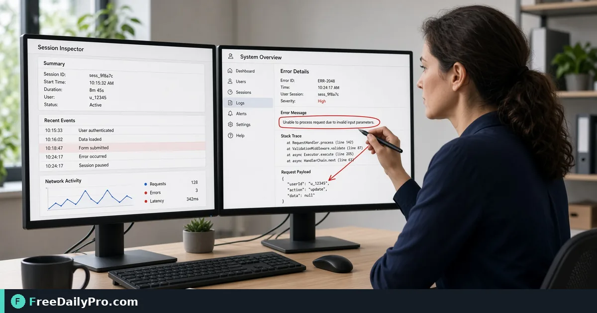

*Grab the right region, annotate only what helps, and export without desktop bloat*

[FreeDailyPro.com](https://www.freedailypro.com) -- Saying it looks wrong on my screen wastes time without a picture. Full desktop installs are overkill for a single red error toast. A focused screenshot with a clear name moves the conversation forward.

## Quick answer

Use [Screenshot Tool](https://www.freedailypro.com/tool/screenshot-tool) to capture the region that shows the problem or the step. Combine several frames into one PDF handoff with [Image to PDF](https://www.freedailypro.com/tool/image-to-pdf) when a reviewer wants a single attachment. Among 200+ professional tools, this is for capture and handoff—not for rewriting the app under test.

## What to include in the frame

URL or page title if visible, the control that failed, the error text, and OS or browser only if relevant. Crop chat sidebars and unrelated personal data. If the bug is timing-related, capture the state after a refresh and note the time. A single still may not show a flicker; say so in the ticket text.

## Numbered workflow

1. Reproduce the issue once so the screen is stable.
2. Open [Screenshot Tool](https://www.freedailypro.com/tool/screenshot-tool) and capture per the live controls (region or full view as offered).
3. Crop to the minimum that still proves the bug or step.
4. Name files with meaning such as bug-login-empty-token.png or guide-step-03-export.png.
5. For multi-step guides, export each step, then optionally build a PDF with [Image to PDF](https://www.freedailypro.com/tool/image-to-pdf).
6. Attach with expected versus actual written in the ticket—not only the image.

See [image tools](https://www.freedailypro.com/category/image-tools) and [multitool apps](https://www.freedailypro.com/multitool-apps).

## Bug report hygiene

One issue per ticket when possible. Include steps to reproduce in text. Screenshots support the text; they do not replace it. Blur secrets, tokens, and customer PII before you share outside a secure channel. For accessibility bugs, also note font zoom level and whether high-contrast mode was on.

## Guide and training use

Numbered screenshots help onboarding docs. Keep UI language exact. If the product renames a button, update the capture the same day so training does not drift. Store guides where the team actually looks—wiki, ticket, or PDF packet—not only in a private chat scroll.

## Common mistakes

- Capturing the entire desktop with five unrelated windows.
- Giant unscaled images that bury the error in a sea of pixels.
- No filename meaning.
- Leaving session IDs or emails visible in a public channel.
- Annotating so heavily that the original UI is unreadable.
- Forgetting locale or language when the bug is translation-specific.

## Mini case

A support engineer captures three frames: empty state, validation error, network panel status. Files named and dropped into Image to PDF for a vendor who only accepts one attachment. The ticket body still lists reproduction steps in order.

A writer builds a four-step export guide with one crop per step and a short PDF for contractors without CMS access.

## FAQ for capture handoffs

**Full page or region?** Region almost always communicates faster. Full page only when layout across the whole view is the bug.

**Moving video bugs?** A screenshot cannot replace a short screen recording when the defect is motion-only. Say that in the ticket and attach a recording from an approved tool.

**High-DPI scaling?** Note device pixel ratio if the bug is about size on high-DPI displays. The image alone may look sharp while the UI is still wrong for users.

**Dark mode only bugs?** Capture both themes when possible and label filenames accordingly.

## Honest limits

Browser screenshot tools depend on browser permissions and what the page allows. Some protected content cannot be captured. 10 trial usages a day; use a $1 daily pass or $4.99 month plan if you batch heavily. FreeDailyPro offers 200+ professional tools—pair capture with the right follow-up tool for your handoff.

## Step-by-step for a login error ticket

1. Reproduce the error with a test account when possible.
2. Capture the screen at the moment the error toast appears using [Screenshot Tool](https://www.freedailypro.com/tool/screenshot-tool).
3. Highlight the error text and the button you clicked.
4. Blur email addresses and tokens in the URL bar.
5. Export and attach to a ticket titled with the feature name and “login error.”
6. Paste steps: browser, OS, account role, time, expected vs actual.
7. If the flow has three screens, capture each and assemble a short PDF with [Image to PDF](https://www.freedailypro.com/tool/image-to-pdf).

## Working with non-technical reporters

Give them a three-line template: what they clicked, what they expected, what they saw, plus one screenshot. Offer a five-minute call only when the screenshot still cannot show the issue. Most reports improve immediately with markup.

## Archive of fixed bugs

When a bug is fixed, keep one annotated before image in the ticket for regression checks. Future releases can compare quickly. Do not rely on memory of “it used to look broken here.”

## Redaction before you share

Treat every capture as potentially public. Blur API keys, customer names, internal hostnames, and avatar stacks. If you cannot redact safely, paste into an editor first or crop harder.

Agree with your team where screenshots may be stored. Public ticket systems are not private notebooks.

## Writing the companion text

A strong ticket has: environment, steps, expected, actual, and the image. The image is evidence. Without text, engineers guess. Without images, they re-ask for proof. Ship both.

For how-to guides, put the action verb in the caption: "Click Export," not "This is the export screen maybe."

## Version drift and product updates

UI renames break guides. When you ship a product change, schedule a capture refresh. Keep a simple inventory of guide screenshots and the app version they match.

## Performance and large images

Huge PNGs clog chat tools. Capture at the size that still shows pixels of the error, then compress lightly if your chat compresses poorly on its own. Prefer clarity of the error text over desktop wallpaper detail.

## Extra worked example

A SaaS support lead builds a template: three screenshots max per ticket, filenames with ticket id prefix, Image to PDF only when a partner email gateway blocks multiple images. Weekly review deletes tickets older than policy that still hold PII in images.

## Security review of screenshots

Before a screenshot leaves your company, ask whether it shows customer PII, internal hostnames, or unreleased UI. Blur or crop. If the bug is in a sensitive admin panel, share only in the private ticket system, not in a public chat channel.

## Product managers and QA

PMs can attach annotated shots to acceptance criteria. QA can attach them to failed test cases with the build number in the ticket title. Designers can mark spacing issues with arrows instead of long geometry essays. The same [Screenshot Tool](https://www.freedailypro.com/tool/screenshot-tool) serves each role with different annotation habits.

## Localization bugs

When a translation overflows a button, capture the full control and a bit of surrounding layout. Note the language and locale in the ticket. Engineers need to know it is not “just English.”

## Building an internal how-to library

Quarterly, export the ten most common support how-tos as PDFs via [Image to PDF](https://www.freedailypro.com/tool/image-to-pdf). Retire guides when the UI changes. Outdated arrows train users to click the wrong place.

## Performance of communication

A 200 KB annotated PNG usually beats a 12 MB raw desktop capture. Crop. Annotate. Export. Your ticketing system and your coworkers’ laptops will thank you. Browse [image tools](https://www.freedailypro.com/category/image-tools) for compression if attachments still strain email.

## Closing next step

Capture one real bug or guide step with [Screenshot Tool](https://www.freedailypro.com/tool/screenshot-tool) and rename the file before you upload it.

What do teammates still miss in your screenshots—region, naming, or privacy redaction? Message us via [contact](https://www.freedailypro.com/contact).
