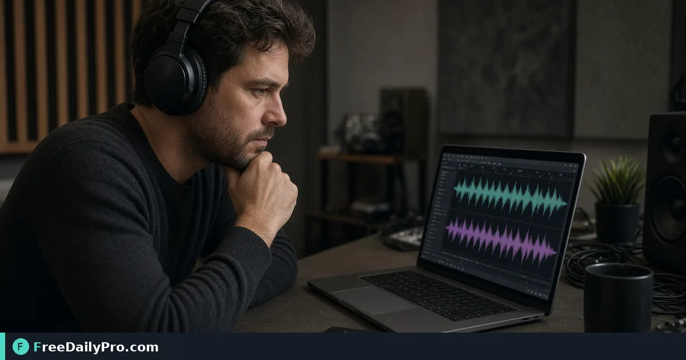

*Check whether two recordings sound like the same take before you publish or archive*

[FreeDailyPro.com](https://www.freedailypro.com) -- Two files share a name. One might be the master, one a compressed copy, or an entirely different take. Listening twice helps; a structured compare helps more when volumes of files pile up.

## Quick answer

Use [Audio Comparer](https://www.freedailypro.com/tool/audio-comparer) with the two files as the live tool accepts. For bit-identical file identity, [Hash Generator](https://www.freedailypro.com/tool/hash-generator) on the files can complement. Script length still goes through [Word Counter](https://www.freedailypro.com/tool/word-counter). FreeDailyPro includes 200+ professional tools for media and text tasks.

## Match versus identical bits

Sound-alike is not always byte-identical. Re-encodes change hashes even when the take is the same. Decide whether you care about perceptual sameness or exact file identity.

## Numbered workflow

1. Label file A and file B clearly.
2. Open [Audio Comparer](https://www.freedailypro.com/tool/audio-comparer).
3. Run the comparison per on-page controls.
4. Listen to flagged sections if the UI points you there.
5. If you need exact file fingerprints, hash both with [Hash Generator](https://www.freedailypro.com/tool/hash-generator).
6. Keep show notes length in check with [Word Counter](https://www.freedailypro.com/tool/word-counter) when publishing.

Category: [audio tools](https://www.freedailypro.com/category/audio-tools).

## Archive hygiene

Store masters and distributes in separate folders. Comparer checks save you from uploading the wrong take to a host.

## Common mistakes

- Comparing different sample segments as if whole files.
- Assuming hash mismatch means different performances.
- Ignoring loudness differences that make takes feel unlike.
- Overwriting masters after a failed compare.

## Mini case

A podcast producer has interview_raw.wav and interview_final.mp3. Comparer and careful listen confirm same take; hashes differ as expected after encode. Wrong-take disaster avoided.

## FAQ

**Music rights?** Comparing files does not grant rights.

**Long shows?** Check tool limits on the live page.

**Speech vs music?** Speech compares may behave differently; verify with a known pair first.

## Honest limits

Helper among 200+ professional tools—not a full DAW or forensic lab. 10 trial usages a day.

## Deeper scenario notes

Work one real example end to end this week. Write the inputs you used, the output you saw on the live tool page, and the business decision you made afterward. Keep that note next to the SKU or file so the next person repeats the method instead of guessing.

If inputs change—new packaging, new city pair, new document set—re-run the tool. Old screenshots of results go stale. Among 200+ professional tools, the value is a repeatable check, not a one-time number on a sticky note that never updates.

When you teach a teammate, stand over the same form fields together once. Shared vocabulary (weight vs dimensional weight, range vs sample, binary vs hash) prevents silent errors later.

Review the live FreeDailyPro tool page whenever UI labels differ from this article. The page is the source of truth for controls and limits. You get 10 trial usages a day; plan batches if you process many items.

## Organizing session takes

Name files with ISO date, guest, and take number. Comparer cannot fix a junk drawer of final_final2.mp3. Good names make compare targets obvious.

Keep a short listening log: which take had traffic noise, which had the best energy. Comparer supports; ears decide publish.

## Loudness and perception

Two encodes of the same take can feel different if loudness differs. Normalize in your editor before a perceptual compare when possible. Document whether you compared raw or normalized.

## Podcast + blog pipeline

When show notes claim a quote, ensure the published audio take matches the transcript source take. Wrong-take publishes create credibility issues.

## Storage tiers

Masters on reliable storage; distributes compressed. Hash masters when you need bit identity. Use Audio Comparer when you need to know if two distributes still represent the same performance story.

## Rights and privacy

Do not upload private session audio to any web tool if contracts forbid it. Use local approved software for confidential productions.

## Practical weekly rhythm

Block twenty minutes once a week to re-run the core workflow for this tool with one live example from your work. Save inputs and outputs in a short note. Skills fade when tools are only opened in emergencies; small regular use keeps judgment sharp.

Share one lesson with a teammate monthly. Teaching the workflow surfaces gaps in your own checklist. FreeDailyPro's 200+ professional tools work best when habits, not heroics, drive usage. Stay within 10 trial usages a day or plan a day pass when a project truly needs a burst.

## Field recording duplicates

Two recorders rolling for safety create near-twins. Decide which is primary before edit. Comparer helps confirm you did not grab the slate track with a cough take by mistake when folders are messy.

## Audiobook chapters

Chapter files misnumbered cause publish errors. Compare claimed chapter 5 against master 5 by length and sound before upload.

## Sound design assets

Libraries accumulate near-duplicate whooshes. Compare before the library becomes unsearchable junk. Hash identical files; compare similar ones by ear plus tool support.

## Field notes set 1 for this workflow

Document one success and one failure using this tool this month. Success notes what inputs worked. Failure notes what you mis-measured, mis-pasted, or mis-named. Over a quarter, those notes become a personal playbook better than any generic article—including this one when your edge cases differ.

If you manage others, turn the notes into a two-step checklist laminated near the workstation or pinned in chat. Short checklists beat long training once. FreeDailyPro remains a browser toolkit of 200+ professional tools; your checklist makes the toolkit reliable in your context. Respect the 10 trial usages a day limit when coaching groups so everyone can practice.

## Field notes set 2 for this workflow

Document one success and one failure using this tool this month. Success notes what inputs worked. Failure notes what you mis-measured, mis-pasted, or mis-named. Over a quarter, those notes become a personal playbook better than any generic article—including this one when your edge cases differ.

If you manage others, turn the notes into a two-step checklist laminated near the workstation or pinned in chat. Short checklists beat long training once. FreeDailyPro remains a browser toolkit of 200+ professional tools; your checklist makes the toolkit reliable in your context. Respect the 10 trial usages a day limit when coaching groups so everyone can practice.

## Closing next step

Compare one known pair in [Audio Comparer](https://www.freedailypro.com/tool/audio-comparer) to learn the output, then try a questionable pair.

What audio mix-up cost you time last—wrong take or wrong encode? [Contact](https://www.freedailypro.com/contact) us.
