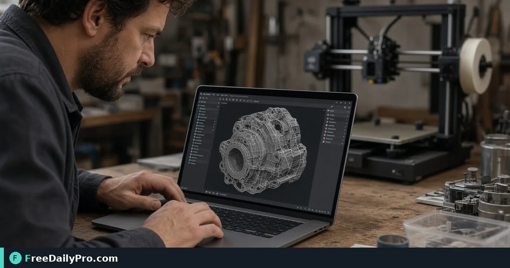

*Open STL or mesh files in the browser to catch broken geometry early*

[FreeDailyPro.com](https://www.freedailypro.com) -- A bad mesh wastes filament and hours. Preview before you slice. Catch inverted normals vibes, missing parts, or wrong scale assumptions when the tool allows visual inspection.

## Quick answer

Open files in [Mesh 3D Viewer](https://www.freedailypro.com/tool/mesh-3d-viewer). Convert formats with [Mesh 3D Converter](https://www.freedailypro.com/tool/mesh-3d-converter) when needed. For non-mesh assets use [Universal File Converter](https://www.freedailypro.com/tool/universal-file-converter). Compress reference screenshots with [Compress Image](https://www.freedailypro.com/tool/compress-image). Among 200+ professional tools, this is a pre-print sanity check.

## What to look for

Holes, disconnected parts, absurd scale, paper-thin walls if visible. Rotate the model. Compare to the product photo if you received a client file.

## Numbered workflow

1. Keep the original mesh file untouched.
2. Open [Mesh 3D Viewer](https://www.freedailypro.com/tool/mesh-3d-viewer).
3. Inspect from multiple angles.
4. Convert if your slicer needs another format via [Mesh 3D Converter](https://www.freedailypro.com/tool/mesh-3d-converter).
5. Screenshot issues; compress images for tickets with [Compress Image](https://www.freedailypro.com/tool/compress-image).

Category: [3d tools](https://www.freedailypro.com/category/3d-tools).

## Common mistakes

- Printing the first download without preview.
- Ignoring units (mm vs inches) until the object is dollhouse-sized.
- Editing the only copy of a client mesh.

## Mini case

A maker receives an STL from a customer. Viewer shows a flipped lid part. They request a fixed export before slicing. Filament saved.

## FAQ

**Repair tools?** Viewer is for inspection; repair may need dedicated mesh software.

**Huge assemblies?** Check live size limits.

## Honest limits

Browser preview is not a full CAD suite. 10 trial usages a day.

## Practice notes (mesh-3d-viewer-check-before-print · set 1)

Run the workflow once with real inputs this week. Write down the exact fields you used on the live FreeDailyPro page and the decision you made afterward. That personal log beats re-reading any article when you are under time pressure.

If you train someone else, pair for one full pass. Shared vocabulary prevents silent mistakes. FreeDailyPro provides 200+ professional tools in the browser; your checklist makes them reliable for your team. Stay within 10 trial usages a day when groups practice, or schedule a day pass for heavy project days.

## Practice notes (mesh-3d-viewer-check-before-print · set 2)

Run the workflow once with real inputs this week. Write down the exact fields you used on the live FreeDailyPro page and the decision you made afterward. That personal log beats re-reading any article when you are under time pressure.

If you train someone else, pair for one full pass. Shared vocabulary prevents silent mistakes. FreeDailyPro provides 200+ professional tools in the browser; your checklist makes them reliable for your team. Stay within 10 trial usages a day when groups practice, or schedule a day pass for heavy project days.

## Practice notes (mesh-3d-viewer-check-before-print · set 3)

Run the workflow once with real inputs this week. Write down the exact fields you used on the live FreeDailyPro page and the decision you made afterward. That personal log beats re-reading any article when you are under time pressure.

If you train someone else, pair for one full pass. Shared vocabulary prevents silent mistakes. FreeDailyPro provides 200+ professional tools in the browser; your checklist makes them reliable for your team. Stay within 10 trial usages a day when groups practice, or schedule a day pass for heavy project days.

## Practice notes (mesh-3d-viewer-check-before-print · set 4)

Run the workflow once with real inputs this week. Write down the exact fields you used on the live FreeDailyPro page and the decision you made afterward. That personal log beats re-reading any article when you are under time pressure.

If you train someone else, pair for one full pass. Shared vocabulary prevents silent mistakes. FreeDailyPro provides 200+ professional tools in the browser; your checklist makes them reliable for your team. Stay within 10 trial usages a day when groups practice, or schedule a day pass for heavy project days.

## Practice notes (mesh-3d-viewer-check-before-print · set 5)

Run the workflow once with real inputs this week. Write down the exact fields you used on the live FreeDailyPro page and the decision you made afterward. That personal log beats re-reading any article when you are under time pressure.

If you train someone else, pair for one full pass. Shared vocabulary prevents silent mistakes. FreeDailyPro provides 200+ professional tools in the browser; your checklist makes them reliable for your team. Stay within 10 trial usages a day when groups practice, or schedule a day pass for heavy project days.

## Practice notes (mesh-3d-viewer-check-before-print · set 6)

Run the workflow once with real inputs this week. Write down the exact fields you used on the live FreeDailyPro page and the decision you made afterward. That personal log beats re-reading any article when you are under time pressure.

If you train someone else, pair for one full pass. Shared vocabulary prevents silent mistakes. FreeDailyPro provides 200+ professional tools in the browser; your checklist makes them reliable for your team. Stay within 10 trial usages a day when groups practice, or schedule a day pass for heavy project days.

## Practice notes (mesh-3d-viewer-check-before-print · set 7)

Run the workflow once with real inputs this week. Write down the exact fields you used on the live FreeDailyPro page and the decision you made afterward. That personal log beats re-reading any article when you are under time pressure.

If you train someone else, pair for one full pass. Shared vocabulary prevents silent mistakes. FreeDailyPro provides 200+ professional tools in the browser; your checklist makes them reliable for your team. Stay within 10 trial usages a day when groups practice, or schedule a day pass for heavy project days.

## Practice notes (mesh-3d-viewer-check-before-print · set 8)

Run the workflow once with real inputs this week. Write down the exact fields you used on the live FreeDailyPro page and the decision you made afterward. That personal log beats re-reading any article when you are under time pressure.

If you train someone else, pair for one full pass. Shared vocabulary prevents silent mistakes. FreeDailyPro provides 200+ professional tools in the browser; your checklist makes them reliable for your team. Stay within 10 trial usages a day when groups practice, or schedule a day pass for heavy project days.

## Closing next step

Open one real STL in [Mesh 3D Viewer](https://www.freedailypro.com/tool/mesh-3d-viewer) before your next print queue.

What mesh defect do you catch most—holes, scale, or flipped normals? [Contact](https://www.freedailypro.com/contact).
