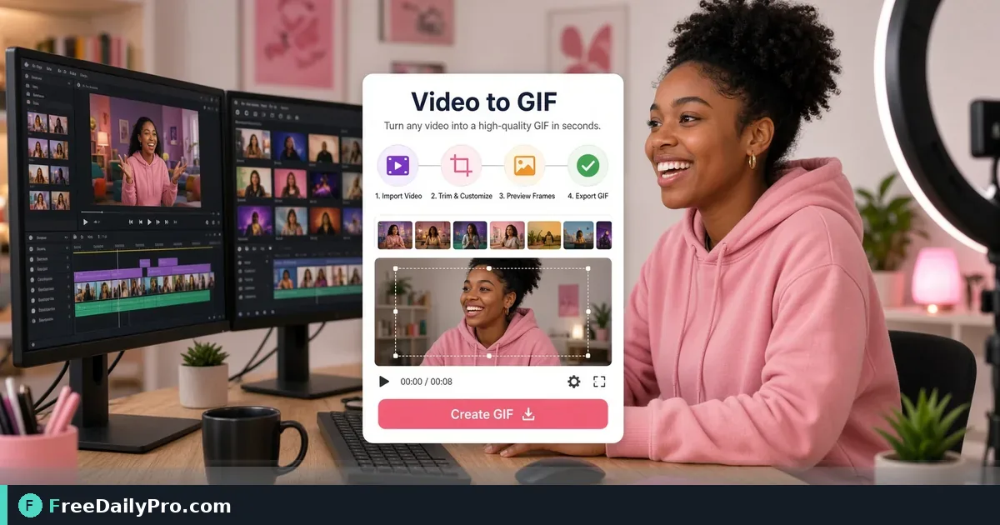

*Create lightweight looping GIFs from video for chats, docs, and social previews*

[FreeDailyPro.com](https://www.freedailypro.com) -- Platforms and chat apps still lean on GIF loops for reactions and quick demos. A short MP4 becomes a looping GIF with [Video to GIF](https://www.freedailypro.com/tool/video-to-gif). Keep clips short so files stay usable.

## Quick answer

Open [Video to GIF](https://www.freedailypro.com/tool/video-to-gif), upload a short clip, convert using the controls on the page, download the GIF. If you also export a cover still, shrink it with [Compress Image](https://www.freedailypro.com/tool/compress-image). Among 200+ professional tools, video-to-GIF is for moments when autoplay video is blocked but motion still helps.

## When GIF beats video

Email clients that block video. Documentation that needs inline motion without a player. Social places that accept GIF natively. Internal chats that expect a loop. For long tutorials, prefer real video hosting instead of giant GIFs.

## Numbered workflow

1. Trim your source clip to a few seconds of the real action (use your editor first if needed).
2. Open [Video to GIF](https://www.freedailypro.com/tool/video-to-gif).
3. Upload the short file.
4. Apply the conversion options shown on the live tool.
5. Download and preview the loop for speed and clarity.
6. If you need a static poster frame for a thumbnail, export a frame and run [Compress Image](https://www.freedailypro.com/tool/compress-image).
7. Upload the GIF where your channel accepts it.

Category: [video tools](https://www.freedailypro.com/category/video-tools).

## Common mistakes

- Converting a three-minute video into a multi-megabyte GIF nobody can open.
- Tiny text in the clip that becomes unreadable after conversion.
- Using GIF where the platform prefers native short video for reach.
- Forgetting that GIF is usually not the archival master—keep the MP4.

## Mini case

A product marketer clips a two-second UI toggle. Video to GIF produces a loop for the help center and Slack. The team understands the feature without a meeting. A compressed still serves as the article header.

## FAQ

**Quality vs size?** Shorter duration and smaller dimensions help more than endless re-encoding.

**Transparent backgrounds?** Depends on source and tool options—check the live page; many social GIFs are full-frame video captures.

**Audio?** Classic GIFs are silent. If you need sound, keep video.

## Honest limits

Browser conversion has file size and length practical limits. Trial usage is 10 trial usages a day. Huge files may fail—trim first. GIFs are rarely ideal for long-form content.

## Pick the right three seconds

The best GIF is a tight loop: a button toggles, a chart animates one step, a before/after wipes. Long lead-ins waste file size. Edit the source clip first so Video to GIF only converts the moment that matters.

## Size expectations

Chat apps and docs choke on huge GIFs. Aim for short duration and modest dimensions. If the loop is sluggish, shorten frames or reduce resolution at the source. Users close tabs for multi-megabyte reaction clips.

## Where GIFs still win

Bug reports that show a one-second glitch. Onboarding docs that show a click path. Social comments that need motion without sound. Internal demos when video players are blocked. When you need narration, record real video instead.

## Brand and caption

A GIF without context confuses. Add a caption in the post or a short text overlay in the source video before conversion if text must live inside the frames. Tiny text fails after compression.

## Static companion assets

Many CMS entries want a poster image. Grab a representative frame and run [Compress Image](https://www.freedailypro.com/tool/compress-image) so the page header stays light. Keep the GIF for inline motion only.

## Accessibility

Motion can distract or trigger discomfort. Prefer shorter loops and avoid rapid flashing. Provide text description of what the GIF shows in surrounding copy so the point is not only visual.

## Source format notes

Clean MP4 clips convert more predictably than huge screen recordings full of idle mouse movement. Crop to the UI region when the point is a control, not the whole desktop.

## Team library

Store approved GIF demos next to product version numbers. Outdated UI loops mis-train users. Retire GIFs when the product changes. Version the filename: feature-toggle-v3.gif.

## Social platform nuance

Some networks rewrite or recompress uploads. Preview after upload, not only on your laptop. If quality collapses, shorten further or switch to native video on that network.

## Legal and privacy

Do not GIF customer data, private dashboards, or faces without rights. Use sample data for public posts. Internal bug GIFs still need care when they show personal information.

## Practice workflow

1. Capture or export a short MP4.
2. Trim to the action.
3. Convert with [Video to GIF](https://www.freedailypro.com/tool/video-to-gif).
4. Preview loop three times.
5. Upload to the destination and preview again.
6. Archive the MP4 master.

## Honest limits

GIF color and compression are older technology. Modern short video often looks better. Use GIF when the channel expects it or when silence and loop matter. Trial usage is 10 trial usages a day. Very long sources should be trimmed before you hit convert.

## Creative tip

Loop endpoints should match. A jump cut at the seam makes the GIF feel broken. Choose start and end frames that continue visually when the loop restarts.

## Changelog communication

Product updates often need a two-second motion proof. Record the new control, convert with [Video to GIF](https://www.freedailypro.com/tool/video-to-gif), drop into the release note. Support tickets drop when users see the motion instead of only reading a paragraph about where the button moved.

## Naming and storage

Save exports as product-feature-action.gif with a date. Store masters in a shared drive with the source MP4. Delete experimental loops that never shipped so the library stays trusted. When design refreshes the UI, schedule a GIF refresh the same sprint.

Test the GIF on mobile data once—slow networks reveal size problems desktop wifi hides.

Keep the MP4 master even after a perfect GIF export. You will need it when a platform rejects GIF uploads next quarter and asks for native video instead.

## Next step

Open [Video to GIF](https://www.freedailypro.com/tool/video-to-gif) with a clip under a few seconds. Generate the loop, preview it full screen, then ship it to the channel that needed motion without a video player.

What GIF use case should FreeDailyPro document next—bug reports, product tours, or education memes? Reach [contact](https://www.freedailypro.com/contact).
