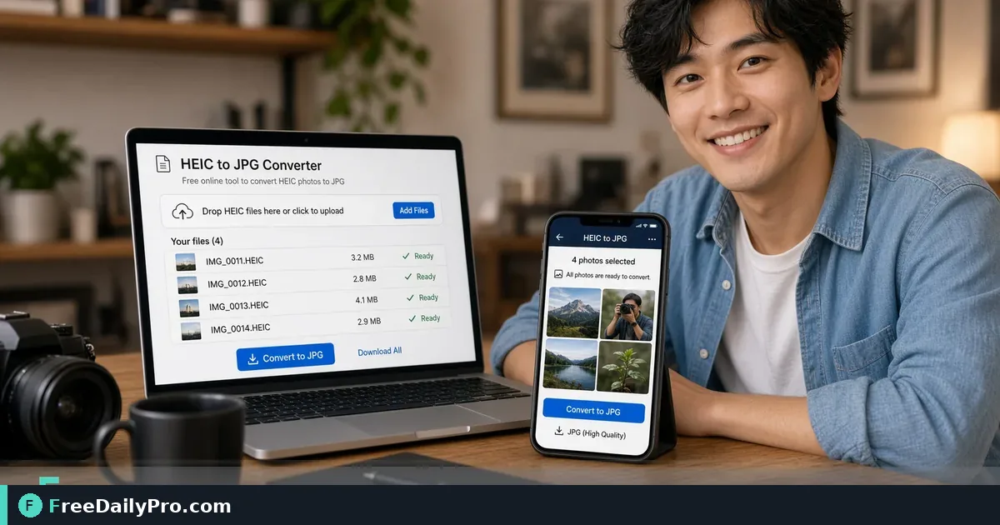

*Turn HEIC camera rolls into JPG or PNG files portals and clients actually accept*

[FreeDailyPro.com](https://www.freedailypro.com) -- iPhones often save HEIC. Many job portals, insurance forms, and client PCs still expect JPG or PNG. Convert once in the browser, then compress if the upload cap is small.

## Quick answer

Open [Convert Image](https://www.freedailypro.com/tool/convert-image), upload the HEIC file, choose JPG or PNG, download. If the portal rejects large files, run [Compress Image](https://www.freedailypro.com/tool/compress-image) next. Among 200+ professional tools, format conversion is the fix when "file type not supported" blocks a form.

## Why HEIC shows up

Apple uses HEIC for efficient storage. Windows and older web forms may not open it. Emailing HEIC to a mixed-device team creates confusion. Convert before you share when the audience is unknown.

## Numbered workflow

1. AirDrop, cable, or cloud the HEIC files to the computer you will convert on.
2. Open [Convert Image](https://www.freedailypro.com/tool/convert-image).
3. Upload one file or batch as the live tool allows.
4. Select JPG for photos that need wide compatibility, or PNG when you need lossless edges for graphics.
5. Download and rename clearly (site-visit-01.jpg).
6. If size still fails an upload limit, open [Compress Image](https://www.freedailypro.com/tool/compress-image) and reduce until under the cap while checking clarity.
7. Upload to the portal or send to the client.

Category: [image tools](https://www.freedailypro.com/category/image-tools).

## Common mistakes

- Emailing original HEIC without asking what the recipient can open.
- Over-compressing after convert until text on a whiteboard is unreadable.
- Leaving cryptic names like IMG_9843.heic after conversion.
- Converting screenshots of screenshots instead of exporting the original photo.

## Mini case

A field tech photographs five serial plates in HEIC. The warranty portal only accepts JPG under 2 MB each. Convert Image produces JPG. Compress Image brings two large shots under the cap. Claim form accepts all five on the first try.

## Quality notes

JPG is fine for most photos. PNG is better for sharp UI captures or graphics with text. If you need print-grade quality, keep a master and only compress the upload copy.

## FAQ

**Batch many photos?** Use whatever batch controls the live Convert Image page offers; otherwise convert in small groups to stay within trial usage.

**Is HEIC "wrong"?** No—it is efficient. Work systems are simply behind.

**Privacy?** Prefer browser tools that process files without forcing an account when the product supports that. Confirm on the live page how files are handled for your case.

## Honest limits

Very large batches may hit browser memory limits. Trial usage is 10 trial usages a day. Always preview the converted file before you delete the HEIC original.

## Work systems that still reject HEIC

Insurance claim portals, older government forms, Windows-heavy offices, and some LMS homework dropboxes still expect JPG or PNG. The photo is fine; the container format is the blocker. Convert before you sit in the form so you are not racing a deadline with a red error banner.

## How to move files off the phone

AirDrop to Mac, USB to a computer, or a cloud folder you control. Avoid posting private work photos to public social just to download them on a desktop. Keep client sites, faces of ID cards, and home interiors off public albums.

## Naming after conversion

site-visit-2026-10-12-01.jpg beats IMG_4821.jpg. When a claims adjuster asks for photo three of the damage, clear names reduce back-and-forth. Batch convert, then rename in order.

## Quality settings in practice

For document photos of paper, higher quality JPG or PNG helps text. For casual product shots, moderate JPG is enough. If a portal caps at 1 MB, convert first, then [Compress Image](https://www.freedailypro.com/tool/compress-image) while zooming on the detail that matters (serial numbers, signatures, damage edges).

## Privacy and sensitive photos

IDs, medical papers, and children's faces need care. Use browser tools you trust for the job, delete local copies you no longer need, and follow your company policy. FreeDailyPro focuses on practical conversion; your policy decides retention.

## Batch days

Field teams often dump thirty photos at once. Convert in groups if the browser slows. Keep a checklist: convert, compress if needed, upload, mark done. Losing track causes duplicate uploads and missing frames.

## Color and screenshots

HEIC photos from camera differ from PNG screenshots of apps. Screenshots often should stay PNG to keep UI text sharp. Camera photos usually become JPG for size. Choose format by content type, not habit.

## Cross-platform sharing

You send HEIC to a contractor on Android; they cannot open it easily. Convert before send when the audience is mixed. One minute of conversion saves thirty minutes of "I can't open this" messages.

## When not to convert

If the only viewer is another iPhone user and the workflow is casual, HEIC is fine. If print labs or pro editors request original quality files, ask what they want before destroying masters. Keep originals until the job closes.

## Troubleshooting

Conversion fails: try one file at a time, confirm the file is not corrupted, confirm it is actually HEIC. Output looks washed out: try a different quality setting or PNG. Portal still rejects: check dimensions and file size caps separately from format.

## Workflow with FreeDailyPro

[Convert Image](https://www.freedailypro.com/tool/convert-image) handles the format step. [Compress Image](https://www.freedailypro.com/tool/compress-image) handles the size step. Do not skip visual QA. Among 200+ professional tools, these two remove most phone-photo upload friction.

## Team standard

Write a two-line SOP: "Export HEIC to JPG before any client or portal upload. Compress only after you check legibility." New hires stop inventing one-off workarounds.

## Client delivery packet

When a client expects a zip of site photos, convert the whole set to JPG, compress only the oversized ones, and include a simple index text file listing filenames and what each shows. That packet opens on Windows and Mac without HEIC friction. FreeDailyPro conversion is the first step; clear labeling is the second.

## Next step

Open [Convert Image](https://www.freedailypro.com/tool/convert-image) with one HEIC from your phone. Export JPG. If the file is heavy, run [Compress Image](https://www.freedailypro.com/tool/compress-image) and retry the upload that failed yesterday.

What image format headache should FreeDailyPro cover next—WebP for web, TIFF for print, or PDF from photos? Write us at [contact](https://www.freedailypro.com/contact).
