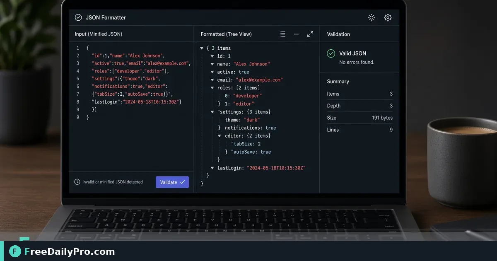

*Pretty-print, spot missing braces, and share readable JSON with teammates without broken deploys*

[FreeDailyPro.com](https://www.freedailypro.com) -- Minified JSON is fine for machines and painful for humans. One missing comma blocks a deploy. Format the payload, fix syntax, then share a readable sample. Pair with URL encoding and hashes when debugging full request chains.

## Quick answer

Paste into [JSON Formatter](https://www.freedailypro.com/tool/json-formatter). Pretty-print or minify as needed. Fix reported syntax issues. Encode query pieces with [URL Encoder](https://www.freedailypro.com/tool/url-encoder). Fingerprint a payload with [Hash Generator](https://www.freedailypro.com/tool/hash-generator) when you compare two environments. Among 200+ professional tools, JSON formatting is daily work for anyone touching APIs.

## When you need it

Config files from a colleague arrive as one line. API error bodies are nested five levels deep. You need to compare staging vs production shapes quickly. Readable structure surfaces the real bug faster than staring at a wall of text.

## Numbered workflow

1. Copy the raw JSON from logs, Postman, or a file.
2. Open [JSON Formatter](https://www.freedailypro.com/tool/json-formatter).
3. Paste and run format/validate using the controls on the page.
4. If invalid, read the error location, fix the source, re-paste.
5. Minify only when you need a compact string for a specific field.
6. For query strings around the same request, use [URL Encoder](https://www.freedailypro.com/tool/url-encoder).
7. To confirm two files match byte-for-byte after edits, hash them with [Hash Generator](https://www.freedailypro.com/tool/hash-generator).

Category: [security tools](https://www.freedailypro.com/category/security-tools).

## Common mistakes

- Editing production secrets inside a shared formatter session on a borrowed machine—prefer local judgment about sensitive data.
- Treating invalid JSON as "the API is down" when the client built a bad body.
- Pretty-printing then pasting back into a system that requires minified input without switching modes.
- Forgetting trailing commas that some editors allow but strict JSON does not.

## Mini case

A mobile release fails because a feature flag file has a trailing comma after the last property. JSON Formatter flags the syntax. Developer removes the comma, validates, ships a hotfix. Hash Generator confirms staging and the fix branch now match the intended config hash.

## FAQ

**Does formatting change meaning?** Pretty-print should preserve structure; minify removes whitespace only. Content values stay the same if syntax was already valid.

**Huge files?** Browser memory has limits. Split large dumps when the page struggles.

**YAML or XML?** Use the right tool for those formats; this post is about JSON.

## Honest limits

The formatter does not call your API. It does not fix business logic. Trial usage is 10 trial usages a day. Never paste live production secrets into any online tool if your policy forbids it—use offline workflows when required.

## Readability is a debugging tool

Nested objects hide missing fields. Pretty-print reveals that `user.id` is null while `userId` is set. That single insight can save an hour of guessing. Format first, theorize second.

## Validation versus schema

JSON Formatter checks syntax: braces, commas, quotes. It does not prove your payload matches a business schema. For schema contracts you still need tests or schema validators in your pipeline. Use the browser tool for quick local sanity.

## Safe handling of secrets

Tokens, passwords, and personal data appear in logs. Prefer redacting before pasting into any shared environment. If policy requires offline-only handling, follow that even when a browser tool is convenient. Hash non-secret payloads with [Hash Generator](https://www.freedailypro.com/tool/hash-generator) when you only need to compare equality.

## API client workflows

Copy from browser network panel, format, fix, send again from your client. Or format a sample for documentation so other developers see structure. Documentation with minified one-liners is how onboarding fails.

## Minify with intent

Some query parameters or environment variables need a single-line JSON string. Minify only at the end after humans finished editing. Keep a pretty copy in the repo for people; emit minified output for machines when required.

## Encoding adjacent problems

Broken requests are sometimes URL encoding issues, not JSON issues. If the body is fine but the query string is messy, switch to [URL Encoder](https://www.freedailypro.com/tool/url-encoder). Debug one layer at a time.

## Compare two environments

Staging returns one shape; production returns another. Format both, place them side by side in your editor, and note field differences. When files should be identical, hash both with [Hash Generator](https://www.freedailypro.com/tool/hash-generator).

## Common syntax traps

Single quotes instead of double quotes. Trailing commas. Unescaped control characters in strings. Comments in JSON (not allowed in strict JSON). The formatter will complain; fix the source generator that produced the bad string so the bug does not return tomorrow.

## Teaching juniors

Have new teammates format every sample they paste into tickets. Readable JSON in tickets reduces back-and-forth. Make it a team norm: "No minified JSON in Slack without a pretty version."

## Performance note

Extremely large JSON may freeze a tab. Split by top-level keys or use local CLI tools for multi-megabyte dumps. The browser tool shines on typical API bodies and config snippets.

## Practice drill

Take a known-good config, break one comma, format, fix, minify, hash. Muscle memory for the happy path and the error path matters more than reading another blog later.

## FreeDailyPro place in the stack

[JSON Formatter](https://www.freedailypro.com/tool/json-formatter) is for quick human-facing cleanup. Your CI still owns formal validation. Together with URL and hash tools under [security tools](https://www.freedailypro.com/category/security-tools), you cover common request debugging without installing another IDE plugin on a locked laptop.

## Incident response snippet

During an outage, paste the error body into [JSON Formatter](https://www.freedailypro.com/tool/json-formatter), capture a screenshot of the pretty tree for the incident channel, and attach the minified original for engineers who need exact bytes. Clear communication shortens mean time to understanding even before mean time to fix.

## Copy-paste hygiene

When copying from terminals, hidden characters and line wrappers can break JSON. Paste into the formatter; if it fails, paste into a plain text editor first to strip rich text, then retry. Keep a known-good sample file in the repo to compare structure during incidents.

Document every public sample you share so juniors learn the shape without scraping production.

## Next step

Open [JSON Formatter](https://www.freedailypro.com/tool/json-formatter) with the last payload that confused you. Format it. Fix one error. If the request uses encoded query params, keep [URL Encoder](https://www.freedailypro.com/tool/url-encoder) nearby.

Which JSON pain should FreeDailyPro document next—schema examples, deep nesting, or diffing two responses? Tell us via [contact](https://www.freedailypro.com/contact).
