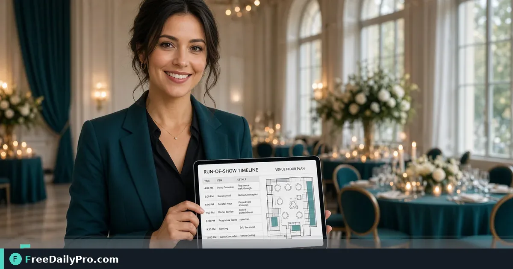

*Merge schedules, signage PDFs, and QR links into one packet staff can open offline*

[FreeDailyPro.com](https://www.freedailypro.com) -- Event day fails in small gaps: staff cannot find the run-of-show, signs are in five email threads, QR codes point to last year’s form. One merged packet with current schedules and signage pages keeps volunteers aligned when wifi wobbles.

## Quick answer

Export run-of-show and sign pages to PDF. Create registration or map links with [QR Generator](https://www.freedailypro.com/tool/qr-generator). Combine everything with [Merge PDF](https://www.freedailypro.com/tool/merge-pdf) in staff order. Among 200+ professional tools, merge-plus-QR covers most day-of document chaos.

Category: [event tools](https://www.freedailypro.com/category/event-tools).

## What belongs in the packet

Cover page with event name and date. Master run-of-show. Room assignments. Emergency contacts. Signage proofs (registration, restrooms, sponsors). QR sheet for check-in or feedback. Map page. Version number and “as of” timestamp on the cover so people know they hold the latest.

## Numbered workflow

1. Freeze the schedule version for print (label it v3 or similar).
2. Export each section to PDF from your editor or design tool.
3. Generate QR codes for live URLs with [QR Generator](https://www.freedailypro.com/tool/qr-generator); test every code on a phone.
4. Merge in walking order for staff with [Merge PDF](https://www.freedailypro.com/tool/merge-pdf).
5. Print two paper copies for the ops table; keep the PDF on offline phones.
6. After last-minute changes, re-merge and rename with a new version—retire old files from the shared drive.

## QR codes that get scanned

Use short, stable URLs. Avoid codes so dense they fail on poster distance. Print a human-readable short link under the code. Test in venue lighting, not only on your desk. Replace codes if the destination URL changes after print.

## Common mistakes

- Merging draft signs with final schedules.
- QR codes still pointing to staging sites.
- No version on the cover.
- Packets so long nobody opens them—split guest vs staff packs.
- Only digital copies when the venue basement has no signal.

## Mini case

A community conference prints a 12-page staff packet: run-of-show, room map, three signs, one QR page for volunteer check-in. Merge PDF builds it in minutes after the final schedule edit. Ops leads stop hunting Slack threads for the “real” times.

## Roles and distribution

Ops lead owns the master PDF. Room leads get paper snippets for their rooms. Volunteers get a one-pager derived from the master, not a 40-page dump. Same source, different extracts—start from one merge, then split if needed with other PDF tools.

## Signage content tips

Huge type, high contrast, arrow clarity, sponsor logos only at approved sizes. Export signs as single-page PDFs before merge so order is controllable. Include a spare blank “custom note” page for handwritten door changes.

## After-action

Store the final packet with photos of posted signs. Next year starts from last year’s structure with new dates. Note which QR destinations changed and why.

## FAQ

**Who prints?** Assign a print owner 48 hours out. Day-of printing is a last resort.

**Guest vs staff packs?** Separate files. Guests do not need emergency radio channels.

**Last-minute speaker change?** Update run-of-show page, re-merge, announce version in staff chat.

## Honest limits

Tools package documents; they do not manage vendors or unions. Trial usage is 10 trial usages a day. Always test QR codes on-site. Paper still matters when batteries die.

## Timeline example

T-7 days: draft packet structure. T-3: freeze design signs. T-2: generate QR, merge v1. T-1: final schedule merge v2, print. Day 0: only emergency one-page addendums.

Stick the timeline on the ops channel so everyone knows when files lock.

## Radio and ops integration

If your team uses channel codes or phonetics, put a one-line radio legend on the packet cover. Staff should not hunt a separate spreadsheet while guests wait. Keep legends short and consistent with training.

## Sponsor deliverables

Sponsor logo signs often arrive late. Leave placeholder pages in the merge order, then replace pages and re-merge when art is final. Never print sponsor marks from chat image previews—use the approved PDF.

## Multilingual events

When signs need two languages, keep each language block large enough to read at distance. Merge English and secondary language versions carefully so room leads grab the right stack. QR destinations can be language chooser pages when appropriate.

## Weather and outdoor contingencies

Outdoor events need a rain plan page in the packet: alternate map, delayed start rules, where to store signs. Update QR codes if the registration tent moves. Re-merge and announce the new version immediately.

## Vendor check-in sheets

Add a simple vendor arrival checklist as its own PDF page before merge. Ops can tick boxes on paper even when the app is offline. Photograph completed sheets for the archive.

## Accessibility of packets

Large type for aging volunteers. High contrast. Alt text is irrelevant on paper, but digital PDFs should still start from text where possible. Provide a one-page large-print run-of-show extract for those who need it.

## Multi-day festivals

Day 1 and Day 2 schedules can be separate merges with a shared emergency page. Color-stripe covers by day if you print. Rehearse packet handoff at volunteer check-in so nobody leaves without the right day.

## Crisis insert

Pre-build a one-page crisis insert template (evacuation meeting point, medical contact). If needed, print and staple onto existing packets without full re-merge of all signage.

## Field notes from real use

Practitioners succeed when they treat this workflow as a checklist, not a one-off experiment. Write your own three-line SOP after the first success: which FreeDailyPro tools you open, in what order, and where files are saved. Share that SOP with teammates so quality does not depend on one person's memory. Revisit the SOP quarterly when tools on the live site gain options you want to adopt.

Keep expectations honest: browser tools remove friction; they do not replace professional judgment in legal, tax, medical, or safety-critical domains.

## Next step

Build a three-page sample: schedule, one sign, one QR from [QR Generator](https://www.freedailypro.com/tool/qr-generator), merged with [Merge PDF](https://www.freedailypro.com/tool/merge-pdf). Use it as the template for your next event.

Which event document should FreeDailyPro focus on next—seating charts, sponsor deliverables, or volunteer briefings? Message [contact](https://www.freedailypro.com/contact).
