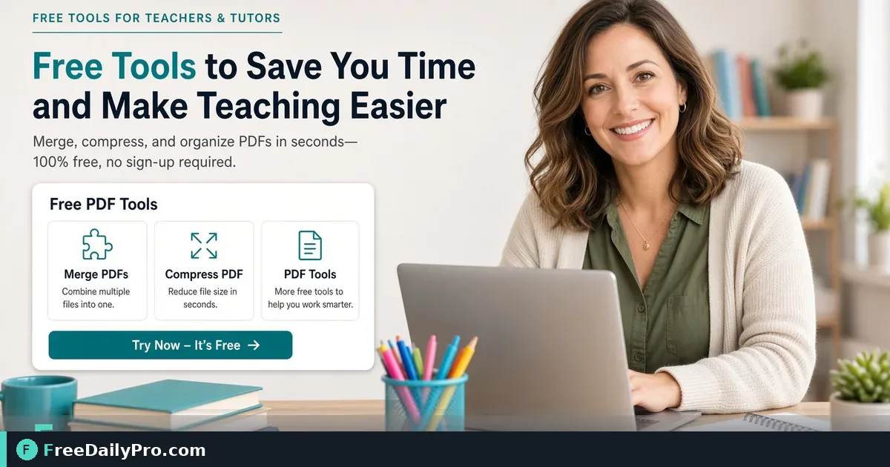

*Turn lesson notes into PDF worksheets, merge sets, and compress for school email limits*

[FreeDailyPro.com](https://www.freedailypro.com) -- Lesson time is short. Converting notes into clean PDF worksheets, merging a weekly pack, and compressing for school email limits should not eat the evening. Use browser tools that work on locked-down school laptops when install rights are limited.

## Quick answer

Draft in your usual editor. Convert with [Word to PDF](https://www.freedailypro.com/tool/word-to-pdf). Combine days or sections with [Merge PDF](https://www.freedailypro.com/tool/merge-pdf). Shrink large scans with [Compress PDF](https://www.freedailypro.com/tool/compress-pdf). Among 200+ professional tools, these three cover most worksheet packet logistics.

Category: [guides](https://www.freedailypro.com/category/guides) and [pdf tools](https://www.freedailypro.com/category/pdf-tools).

## Classroom constraints that matter

Many school machines block installs. Email caps reject 15 MB attachments. Copiers choke on huge image-heavy PDFs. Parents on phones need files that open without specialty software. PDF packs solve distribution better than a pile of editable docs that reflow on every device.

## Numbered workflow

1. Write the worksheet in Word or another editor with clear headings and page breaks between activities.
2. Convert each file through [Word to PDF](https://www.freedailypro.com/tool/word-to-pdf).
3. Preview on phone and laptop for cut-off margins.
4. Merge Monday–Friday or unit sections with [Merge PDF](https://www.freedailypro.com/tool/merge-pdf) in teaching order.
5. If the pack exceeds email limits, run [Compress PDF](https://www.freedailypro.com/tool/compress-pdf) and recheck readability of diagrams.
6. Name files with course, week, and version: Algebra1-Week12-v2.pdf.
7. Upload to the LMS or email with a short note of page counts.

## Design for print and projection

Large fonts help when you project a page. High-contrast black text prints on tired toner better than light gray. Leave margins for hole punches. Number pages so lost sheets can return to the right pack.

Avoid tiny crossword fonts that vanish on shared printers. Test one page on the school copier before you print thirty packs.

## Tutors and small groups

Tutors can keep a master skills folder: fractions warm-ups, reading response frames, lab safety sheets. Merge only what today’s session needs so students are not overwhelmed. Compress when sending to parents on mobile data.

## Common mistakes

- Merging before fixing orientation on scanned pages.
- Compressing until diagrams are unreadable.
- Sending editable docs that students accidentally overwrite.
- Omitting answer keys or attaching keys to the student pack by mistake.
- Using vague filenames like worksheet-final-FINAL2.pdf.

## Mini case

A middle-school science teacher builds three lab sheets and a rubric. Word to PDF converts each. Merge PDF creates one Lab-Week4 pack. Compress PDF fits the LMS upload cap. Students download once; the teacher stops fielding “which file?” messages.

## Accessibility notes

When possible, start from text-based documents so PDF text remains selectable. Pure image scans are harder for assistive tools. If you must scan, use higher quality and avoid heavy compression on text pages.

## Version control for units

Keep an archive of weekly packs by year. When you improve a worksheet, bump the version in the filename and retire the old LMS upload. Stale packs cause students to complete outdated homework.

## FAQ

**Can students edit the PDF?** Use fillable forms only when you intend answers typed on device; otherwise print-oriented PDFs are fine.

**What about Google-only classrooms?** PDF still works as a universal handout format even when drafting happens elsewhere.

**How many pages per pack?** Enough for the week without printing unused fluff. Split huge units.

## Honest limits

These tools format and package; they do not grade. Trial usage is 10 trial usages a day. Very large image scans may need stronger compression settings or fewer photos per page. Always preview after compress.

## Prep night routine

Thirty focused minutes: convert, merge, compress, name, upload. Do it the evening before, not during homeroom. Pair with a simple checklist so substitutes can find the pack without a scavenger hunt.

## Differentiation packets

Advanced and support versions of the same lesson can live as separate PDFs merged into labeled sections. Cover pages should state which group each section serves so aides do not hand the wrong tier. Compress carefully so diagrams in the support version stay clear.

## Substitute teacher readiness

A sub pack is a special worksheet pack: schedule, attendance note, worksheets, answer key sealed separately, and emergency info. Merge the student-facing pages only into what goes on desks. Keep keys in a different file name pattern so they are not projected by mistake.

## Parent communication

When packets go home, add a one-page parent note at the front after merge. Explain due dates and materials needed. Compressed PDFs email more reliably to phones on cellular data.

## Special education and large print

Large-print versions may need separate exports before convert. Do not only magnify a standard PDF if layout breaks. Create intentional large-print sources, convert with [Word to PDF](https://www.freedailypro.com/tool/word-to-pdf), and store alongside standard packs.

## Department shared drives

Agree on folder taxonomy: subject / year / unit / week. Filenames include version and date. When two teachers update the same pack, the higher version wins and the older file moves to an archive folder the same day.

## Assessment packets

Quizzes and exit tickets follow the same convert-merge-compress path. Keep answer keys in a separate password-minded workflow when emailing. Name student and key files so they never share a basename. After grading week, archive packs by term for accreditation evidence.

## Lab and art classes

Photo-heavy instructions inflate PDF size. Photograph once well, compress images before placing in the source document when possible, then use [Compress PDF](https://www.freedailypro.com/tool/compress-pdf) as a final step. Students on limited data thank you.

## Co-planning

Two teachers co-author a unit. Agree who exports the final PDF each week. Dual ownership without a single exporter creates conflicting packs in parent email threads.

## Field notes from real use

Practitioners succeed when they treat this workflow as a checklist, not a one-off experiment. Write your own three-line SOP after the first success: which FreeDailyPro tools you open, in what order, and where files are saved. Share that SOP with teammates so quality does not depend on one person's memory. Revisit the SOP quarterly when tools on the live site gain options you want to adopt.

Keep expectations honest: browser tools remove friction; they do not replace professional judgment in legal, tax, medical, or safety-critical domains.

## Next step

Convert one real worksheet with [Word to PDF](https://www.freedailypro.com/tool/word-to-pdf), merge it into a short pack with [Merge PDF](https://www.freedailypro.com/tool/merge-pdf), and compress if needed with [Compress PDF](https://www.freedailypro.com/tool/compress-pdf).

What classroom PDF workflow should FreeDailyPro document next—quizzes, permission slips, or sub plans? Tell us on [contact](https://www.freedailypro.com/contact).
