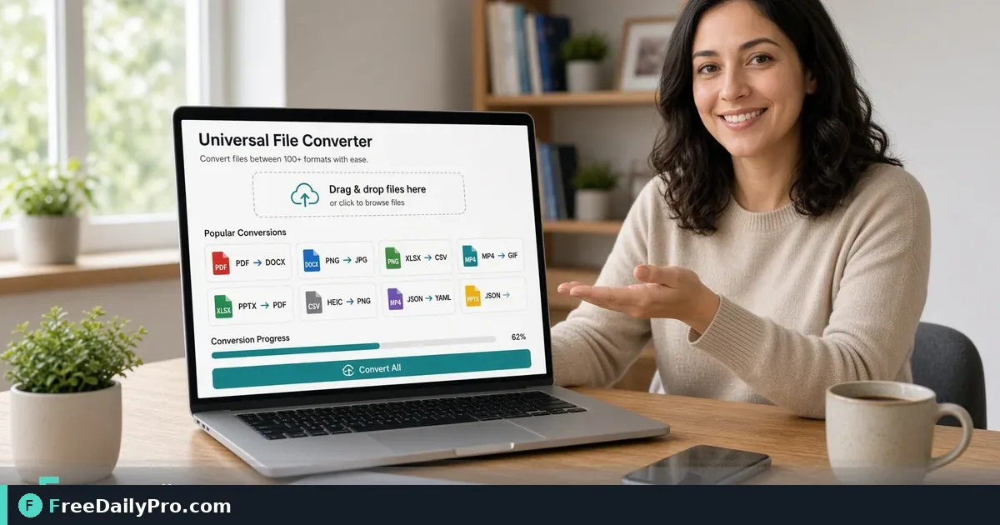

*Move between everyday formats in the browser when a colleague sends the wrong type*

[FreeDailyPro.com](https://www.freedailypro.com) -- Someone sent a format your software will not open. Installing a full desktop suite for one file is slow. A browser converter handles many everyday swaps so you can keep moving.

## Quick answer

Use [universal-file-converter](https://www.freedailypro.com/tool/universal-file-converter), [compress-pdf](https://www.freedailypro.com/tool/compress-pdf), [convert-image](https://www.freedailypro.com/tool/convert-image). Among 200+ professional tools, start with the one that matches today's file or calculation—not a tour of everything. Category: [converters](https://www.freedailypro.com/category/converters).

## What changed in this rewrite

Older site copy was thin, repeated boilerplate, or used wording that no longer matches site messaging. This version is a full practical guide: steps, mistakes, limits, and a contact question. No software-hype language. No invented statistics.

## Numbered workflow

1. State the outcome in one sentence.
2. Confirm the file type or numbers you actually have.
3. Open https://www.freedailypro.com/tool/universal-file-converter.
4. Follow the live page controls—trust the page over old screenshots.
5. Preview the result on the device your recipient uses.
6. Use related tools only when they remove a real blocker.
7. Name outputs with project-date-version.
8. Archive inputs beside outputs.

## Worked scenario

You have thirty minutes before a send deadline related to **universal file converter**. You complete one full pass, verify the output, and only then message the recipient. You do not multitask a rebrand and a conversion in the same half hour. Scope discipline is the quiet skill behind reliable packets.

## Common mistakes

- Skipping preview.
- Mixing blank templates with filled outputs in one folder.
- Claiming privacy guarantees you have not verified for that tool.
- Using “trial” language incorrectly—FreeDailyPro uses **10 trial usages** a day.
- Treating calculator outputs as filings or legal conclusions.

## Messaging you can trust on FreeDailyPro

Say **200+ professional tools**. Say **10 trial usages** a day. Prefer “browser-based” and “no install” over overused marketing words. After trial volume needs, a $1 daily pass or $4.99 a month may apply—mention only when the reader needs volume context.

## FAQ

**Is this professional advice?** No. General information only.

**Why rewrite legacy posts?** To meet current structure, length, link, and messaging rules so Claude’s importer accepts them.

**Will URLs change?** REPLACE mode keeps the existing slug and URL history.

## Team habits

Write a three-line SOP after first success. Share it. Review quarterly. Second-person check for sensitive external sends.

## Honest limits

Browser tools help with everyday files and estimates. Huge media, exotic formats, or strict offline policies may need another path. Verify features on the live tool page. Do not invent capabilities.

## Privacy judgment

Only claim in-browser processing when true for the tool you are describing. Do not promise “100% privacy” as a blanket slogan. Follow your company policy for regulated data.

## Deep quality pass

Check filenames, recipients, and whether a sample page should go before a full packet. Keep a failure log. Among 200+ professional tools, the ones you can run under pressure matter most.

## Rehearsal

Practice once with non-critical files. Note every click on the live page. Then run the real job. Rehearsal is cheaper than resends.

## Documentation

Store templates separate from filled outputs. Version cover sheets with “as of” dates. Update SOPs when the live UI changes.

## Closing practice

Ship, verify on a second device, archive. Fix the SOP the same day if something failed.

## Extra field note

Confirm timezone on any deadlines and whether a second reviewer is required before external send.

## Extra field note

Confirm timezone on any deadlines and whether a second reviewer is required before external send.

## Extra field note

Confirm timezone on any deadlines and whether a second reviewer is required before external send.

## Extra field note

Confirm timezone on any deadlines and whether a second reviewer is required before external send.

## Next step

Open https://www.freedailypro.com/tool/universal-file-converter and complete one real task from your queue today.

What should FreeDailyPro improve next on this topic? Tell us on [contact](https://www.freedailypro.com/contact).
